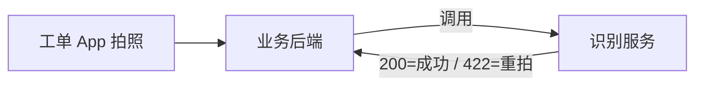
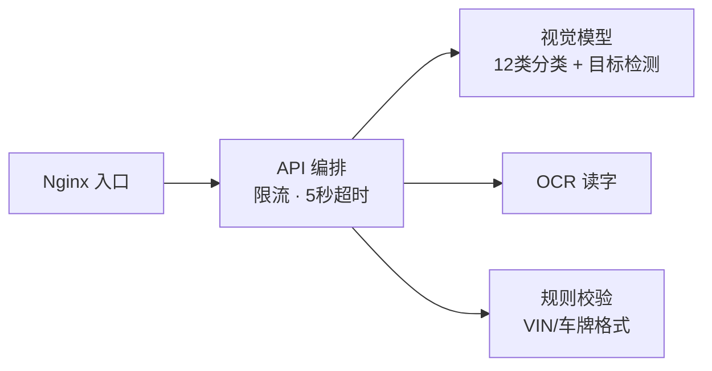
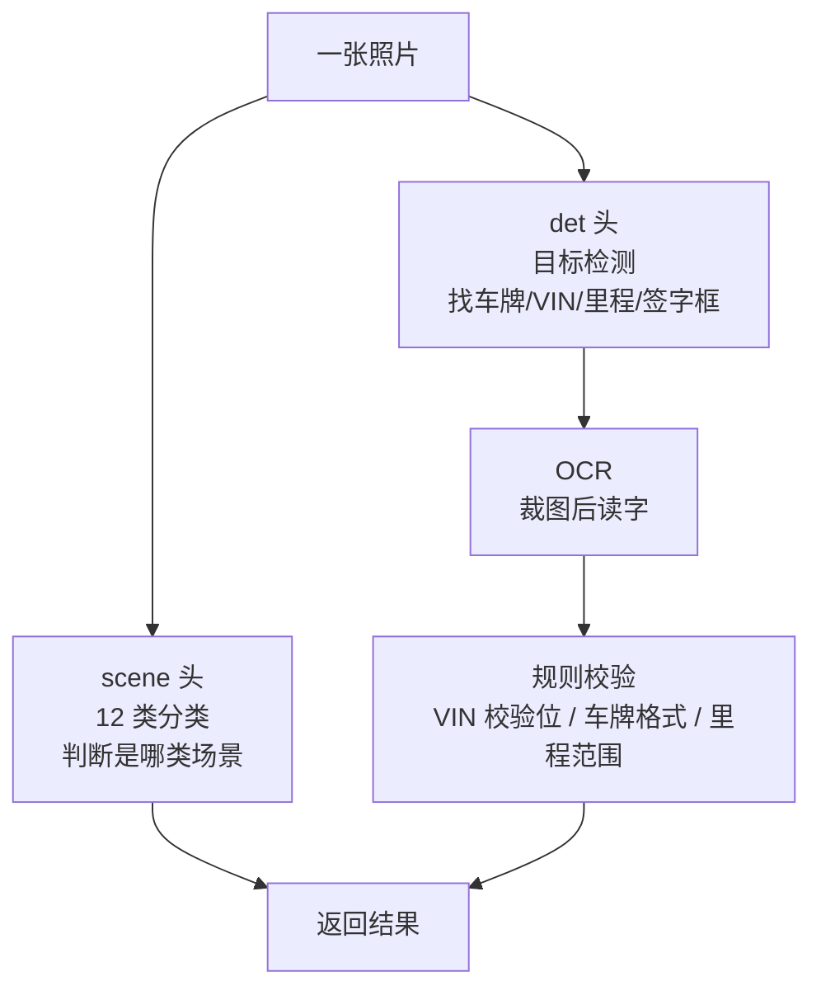
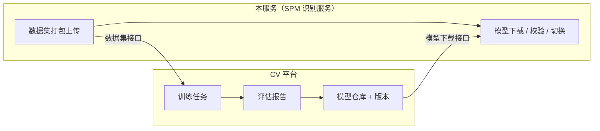
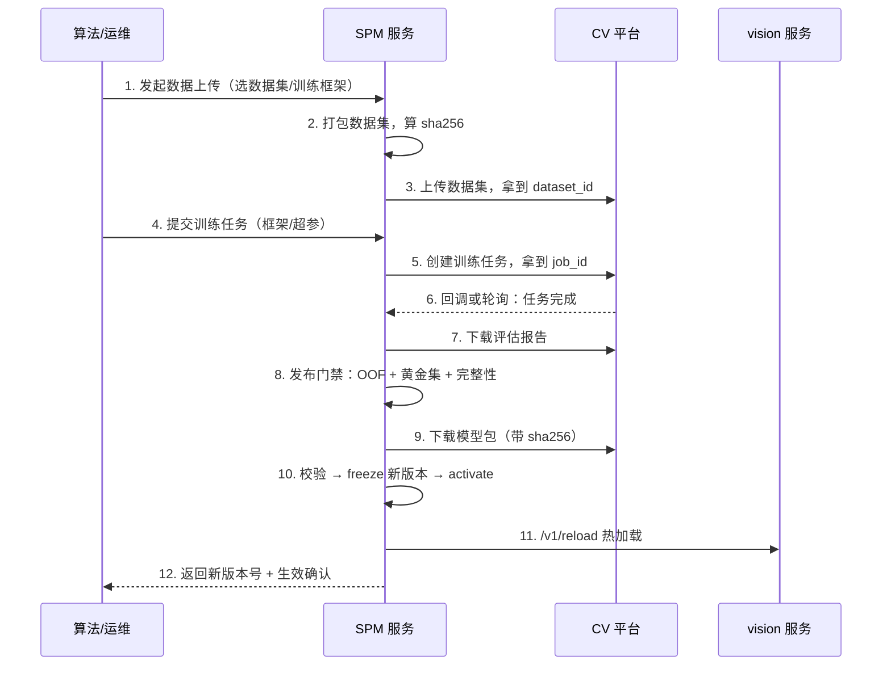
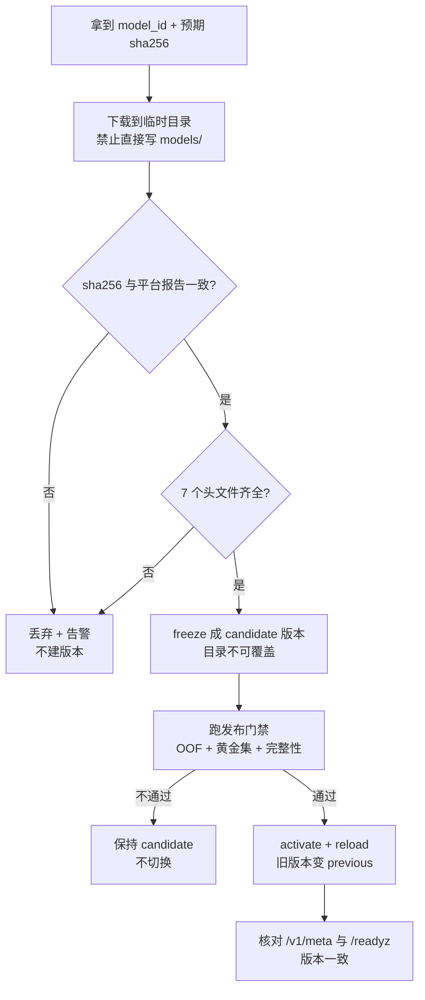
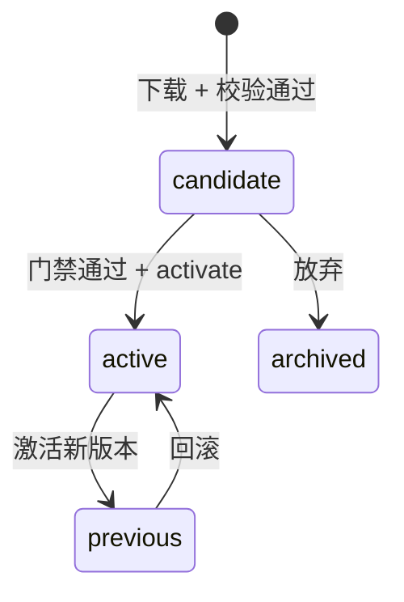
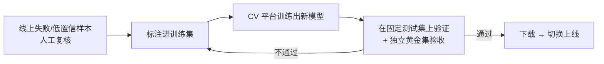

# SPM首保工单图片识别技术方案

## 一、场景说明

用户现场拍一张首保工单照片 → 告诉系统这张图是哪一类（12 种）→ 直接返回能用的信息：车牌、VIN、里程、加油/放油、有没有滤芯、签字盖章。



## 二、技术设计

### 2.1 逻辑设计

**Nginx 收流量 → FastAPI 排队限流 → 视觉模型看类别/找位置 → OCR 读字 → 规则校验 → 返回**



### 2.2 模型说明

| 用途 | 模型 | 输入尺寸 | 类别数 |
| --- | --- | --- | --- |
| 认出是哪类照片 | scene（YOLO26n-cls） | 512×512 | 12 |
| 在照片里找车牌/VIN/签字的位置 | det（YOLO 检测） | 640×640 | 18 个框类别 |
| 读出上面的字 | OCR（RapidOCR） | 原图裁切 | — |
| 油液/滤芯细分纠偏（当前**关闭**） | group / action / bin | 512×512 | 3 / 6 / 2 |

> scene 头负责判断场景；现在 12 类类别本身区分了“桥/轮胎/滤芯”。group、action 和 bin 是一组辅助纠偏模型，当前没有开启，等 7 个头都用同一批数据重新训练后再启用。

### 2.3 为什么这么做

- 数据只有几百到一千多张，大模型只会更慢、更容易过拟合。
- 真正决定速度的是 OCR，不是模型大小。
- 读不到就返回 `422`，让现场重拍，不做猜测。

## 三、模型设计

### 3.1 模型拆成 7 个头 + 1 个 OCR



为什么拆成多个小模型，而不是一个大模型：

| 原因 | 具体说明 |
| --- | --- |
| 每个头可以单独评估、单独换 | 换 det 不影响 scene，出问题好定位 |
| 可以走快路径 | 油液/滤芯只需要 scene 头，约 0.1–0.3 秒，不跑检测和 OCR |
| 训练成本低 | 每个头几百到一两千张就能训，单卡几分钟到几十分钟 |
| 可解释 | 是哪个头判错，一目了然 |

### 3.2 各头的数据从哪来

| 头 | 训练数据 | 数量（当前） | 标签来源 |
| --- | --- | --- | --- |
| scene | 12 个场景文件夹的图片 | 新数据 537 张；新旧合并后共 1306 张（其中 759 张是新数据） | 文件夹名 / 人工改标 |
| det | 照片 + 人工框（车牌、VIN、里程、签字、盖章…） | 200 张（det_v2 候选） | 自动标注 + 人工确认 |
| OCR | RapidOCR 预训练模型，**不训练** | — | 直接使用 |
| group / action / bin | 从 scene 数据集按规则派生 | scene 的子集 | 由 scene 标签派生 |

> **537 张**是清洗后“新数据”的规模，也是 v5 评估的口径；**1306 张**是新旧数据合并后的全部样本，86.98% 就是在它上面算的。

> 训练前必须保证**同一个工单的照片只出现在一个集合里**（训练/验证/测试）。否则同一辆车的照片会同时出现在训练集和测试集里，指标会虚高。

### 3.3 训练配置（当前实际参数）

| 参数 | 值 | 说明 |
| --- | --- | --- |
| 基座模型 | `models/pretrained/yolo26n-cls.pt` | 预训练权重，不从头训 |
| 输入尺寸 | 512×512（scene 与 action/bin 头）；det 头 640×640 | 再大收益不明显，反而变慢 |
| batch | 8 | 单卡显存足够，可调 16 |
| epochs | 25（默认），上限 200 | 有早停，没必要硬跑 |
| 优化器 | auto | 交给 ultralytics 自动选 |
| 学习率 | auto | 同上 |
| 早停 patience | 10 | 10 轮不涨就停 |
| 随机种子 | 42 + fold | 每折固定种子，可复现 |
| 数据增强 | ultralytics 默认（随机裁剪/翻转/色彩） | 没有额外自定义增强 |
| 训练设备 | cuda（生产）/ mps（Mac）/ cpu（调试） | 生产用 cuda |

### 3.4 数据集怎么切

| 集合 | 比例 | 用途 | 能不能拿来调参 |
| --- | --- | --- | --- |
| train | 70% | 训练 | — |
| val | 15% | 选最优 epoch、早停 | 可以 |
| test | 15% | 最终验收 | **不行**，只能看不能调 |

切分单位是**工单**，不是单张图。训练完会在 test 集上自动跑一遍，输出 `test.json`；没有 test 结果就不能作为上线依据。

另外还有一套**5 折交叉验证**：94 个工单平均切成 5 份，每折独立训练一次，得到折外（OOF）准确率。这个数字比单折可信，是当前 86.98% 的出处。

### 3.5 三个指标不能混

| 口径 | 一句话 | 当前值 |
| --- | --- | --- |
| 单折 hold-out | 只在一折上测 | 95.33%（107 张） |
| 5 折 OOF | 5 折轮流当测试，拼起来 | **86.98%**（1306 张） |
| 独立黄金集 | 人工双标、只用一次 | **还没有** |

对外只报 5 折 OOF 和黄金集，单折数字只做内部参考。

## 四、模型训练与管理（对接 CV 平台）

> **结论：训练交给 CV 平台，本服务只做两件事——把数据送上去、把训练好的模型下载下来并切换上线。**

### 4.1 分工



| 环节 | 谁来做 | 本服务做什么 |
| --- | --- | --- |
| 数据准备、切分 | 本服务 | 打包成平台要求格式上传 |
| 训练 | CV 平台 | 不训练，只提交参数 |
| 评估 | CV 平台 | 下载评估报告，跑发布门禁 |
| 模型存储 | CV 平台 | 不自己训，也不长期存训练产物 |
| 下载与上线 | 本服务 | 下载、校验、切版本、回滚 |

这样做的好处：

- 训练和在线推理分开，训练再也不会抢占 GPU、影响线上。
- 平台统一管权限、算力、任务日志，不用再登服务器敲命令。
- 本服务只保留“线上版本 + 上一个版本”，磁盘占用小。

### 4.2 整体流程图



### 4.3 数据上传接口（本服务对外）

训练数据由本服务统一打包后传给平台，平台不需要直接读本服务的目录。

```http
POST /v1/training/datasets
Content-Type: application/json

{
  "name": "spm_scene_v6",
  "task": "classification",
  "source": "all",
  "split": {"train": 0.7, "val": 0.15, "test": 0.15},
  "include_uploads": true
}
```

| 字段 | 说明 |
| --- | --- |
| `name` | 数据集名字，平台侧唯一 |
| `task` | `classification`（scene）/ `detection`（det） |
| `source` | `all`（新旧合并）/ `upload:<批次>` / `built:<名称>` |
| `split` | 三项加起来必须是 1 |
| `include_uploads` | 是否带上业务上传的新数据 |

返回：

```json
{
  "dataset_id": "ds_20261124_001",
  "name": "spm_scene_v6",
  "images": 1842,
  "orders": 128,
  "classes": 12,
  "manifest_sha256": "a1b2…",
  "uploaded_to_cv": true
}
```

**本服务做的事：**

1. 复用现有 `datasets.build_dataset()`：按内容 sha256 去重、按工单切分、人工改标优先；
2. 生成 `manifest.json`（每张图的 split/标签/来源/sha256）；
3. 打成一个 zip，按平台约定格式上传；
4. 把 `dataset_id` + `manifest_sha256` 登记到本地，训练任务后续引用。

### 4.4 提交训练任务接口（本服务对外）

```http
POST /v1/training/jobs
Content-Type: application/json

{
  "dataset_id": "ds_20261124_001",
  "framework": "yolo_cls",
  "head": "scene",
  "version": "v6.0.0",
  "params": {
    "base_model": "yolo26n-cls.pt",
    "epochs": 25,
    "imgsz": 512,
    "batch": 8,
    "folds": [0, 1, 2, 3, 4],
    "seed": 42
  }
}
```

返回：

```json
{
  "job_id": "cv_job_20261124_01",
  "status": "queued",
  "cv_job_url": "http://cv-platform/jobs/cv_job_20261124_01"
}
```

**查询进度：**

```http
GET /v1/training/jobs/cv_job_20261124_01
```

```json
{
  "job_id": "cv_job_20261124_01",
  "status": "succeeded",
  "progress": 1.0,
  "metrics": {
    "oof_top1": 0.881,
    "oof_top5": 0.997,
    "test_top1": 0.873
  },
  "artifact": {
    "model_id": "m_20261124_01",
    "version": "v6.0.0",
    "sha256": "c3d4…",
    "size_bytes": 3212866
  },
  "report_url": "http://cv-platform/reports/20261124/oof.json"
}
```

| status | 含义 | 本服务做什么 |
| --- | --- | --- |
| `queued` / `running` | 排队/训练中 | 只展示进度 |
| `succeeded` | 训练完成 | 自动进入第 4.5 节门禁 |
| `failed` | 失败 | 展示平台错误日志，不下载 |
| `canceled` | 取消 | 同 failed |

### 4.5 模型下载接口（对接平台）

模型包由平台提供下载，本服务按 `model_id` 拉取。**建议平台约定如下格式**，如果平台格式不同，在本服务加一层适配即可。

```http
GET {CV_BASE}/api/v1/models/{model_id}/download
Authorization: Bearer {CV_TOKEN}
```

平台返回：模型包（zip/tar）+ `X-Content-SHA256` 头，或者返回一个带签名的临时下载链接。

**下载的关键是「三合一」必须一起拿到：** 权重 + 训练配置 + 评估报告。只下权重的模型没法复现、没法比较、没法回滚。

```json
{
  "model_id": "m_20261124_01",
  "version": "v6.0.0",
  "task": "scene",
  "files": ["weights/scene.pt", "weights/group.pt", "weights/action.pt",
            "weights/bin_axle.pt", "weights/bin_tire.pt",
            "weights/bin_filter.pt", "weights/det.pt"],
  "sha256": "c3d4…",
  "train_config": {"base_model": "yolo26n-cls.pt", "epochs": 25, "imgsz": 512},
  "dataset_id": "ds_20261124_001",
  "metrics": {"oof_top1": 0.881}
}
```

**本服务下载后做的事，一步都不能省：**



| 检查项 | 不通过怎么办 |
| --- | --- |
| sha256 与平台报告一致 | 丢弃，告警，不建版本 |
| 文件齐全（scene/group/action/bin_*/det） | 丢弃，要求平台重新打标 |
| 版本号不重复 | 拒绝，必须换新版本号（版本目录不可覆盖） |
| 门禁证据齐全 | 保留 candidate，不允许上线 |
| 上线后版本不一致 | 立即回滚到 previous |

### 4.6 下载与更新：系统内两条路径

平台把模型交给本服务后，有两种方式让线上生效：

| 方式 | 做法 | 适用 | 回滚速度 |
| --- | --- | --- | --- |
| **热加载（推荐）** | `activate` 后调 `POST /v1/reload` | 同架构、只换权重 | 秒级 |
| 冷更新 | 模型包随升级包下发，重启 vision 容器 | 换了架构/依赖、换 onnx 推理 | 分钟级 |

**热加载接口：**

```http
POST /v1/models/{version}/activate
Content-Type: application/json

{"evidence": "docs/reports/v6.0.0_release.json"}
```

```http
POST /v1/models/{version}/rollback
```

实际执行：`activate` → 改 `models/current` 软链 → `POST vision:8016/v1/reload` → 拿 `/v1/meta` 和 `/readyz` 核对。

**失败要能一键退回：**

```bash
python scripts/models.py activate v5.1.0 --rollback
curl -X POST http://127.0.0.1:8016/v1/reload
```

### 4.7 版本状态



只保留 `active` + `previous`，更老的版本从平台下载，不在服务器上留一堆历史权重。

### 4.8 配置项

| 变量 | 示例 | 说明 |
| --- | --- | --- |
| `CV_BASE_URL` | `http://cv-platform/api/v1` | 平台地址 |
| `CV_TOKEN` | `***` | 平台访问令牌，放环境变量，不进 git |
| `CV_TIMEOUT_S` | `30` | 接口超时 |
| `CV_DOWNLOAD_TIMEOUT_S` | `300` | 大模型包下载超时 |
| `CV_VERIFY_SHA256` | `1` | 强制校验，生产必须是 1 |
| `MODEL_KEEP_VERSIONS` | `2` | 本地保留版本数 |
| `TRAIN_BACKEND` | `cv_platform` | 训练走后端；本地训练设为 `local` 保留调试能力 |

### 4.9 异常处理

| 场景 | 处理 |
| --- | --- |
| 平台不可达 | 训练提交失败直接返回错误；下载失败重试 3 次（指数退避） |
| 平台任务卡住 | 超过 `CV_JOB_TIMEOUT` 标记为超时，可人工取消 |
| 下载文件损坏 | sha256 不匹配即丢弃，告警 |
| 磁盘不足 | 下载前检查剩余空间 ≥ 2 倍模型包大小 |
| reload 失败 | 保留旧权重继续服务，返回失败原因 |
| 新版本上线后错误率升高 | 看板告警 → 自动回滚到 previous（P1 实现） |

### 4.10 安全与权限

| 项 | 要求 |
| --- | --- |
| 平台令牌 | 只放环境变量，禁止写进代码和日志 |
| 下载接口 | 只允许本服务出口 IP 访问 |
| 模型完整性 | 全部文件 sha256 校验，缺失即拒绝 |
| 操作审计 | 谁在什么时候下载、激活、回滚，记一条审计日志 |
| 平台可见数据 | 上传的是图片和标签，按平台权限分级，不上传原始工单信息 |

## 五、API 接口设计

### 5.1 请求示例

```bash
curl -X POST http://10.51.13.7:8020/v1/recognize \
  -H "X-API-Key: 你的key" \
  -F "scene=license_vin" \
  -F "image=@行驶证.jpg"
```

### 5.2 HTTP 状态码说明

| 状态码 | 意思 | 业务系统怎么做 |
| --- | --- | --- |
| `200` | 识别成功 | 直接用 `data` 里的值 |
| `422` | 这张图没识别出来 | 把 `message` 弹给现场，让他重拍或者人工处理 |
| `400` | 参数传错了 | 改代码 |
| `429` | 太忙 | 等 `Retry-After` 秒再试 |
| `5xx` | 服务挂了 | 重试一次，还不行报障 |

```json
{"scene":"license_vin","message":"识别成功","data":{"vin":"HLC3J2VEXSA603850"}}
```

```json
{"scene":"arrival_plate","message":"未识别到车牌，请靠近或正对车头重拍","data":{"plate":null}}
```

### 5.3 API场景参数说明

| scene | 用途 | data |
| --- | --- | --- |
| `arrival_plate` | 车头车牌 | `plate` |
| `license_vin` / `frame_vin` | 行驶证 / 车架 VIN | `vin` |
| `odometer` | 里程表 | `odometer` |
| `bridge_drain` / `bridge_fill` | 桥放油 / 加油 | `action` |
| `tire_drain` / `tire_fill` | 轮胎放油 / 加油 | `action` |
| `filter_none` / `filter_has` | 无滤芯 / 有滤芯 | `filter_state` |
| `service_front` | 服务单首页 VIN | `vin` / `vin_partial` |
| `service_sign` | 服务单末页 | `signature` / `stamp` |

## 六、后期迭代规划



| 阶段 | 重点 |
| --- | --- |
| 近期 | 先把“下载 → 校验 → 门禁 → 热加载 → 回滚”这条链路跑通 |
| 中期 | 打通线上样本回流，让 CV 平台能直接拿到真实难例 |
| 后期 | 自动发布（指标达标自动切），和平台做模型血缘 |

---

> 完整版（架构、限流、部署、DBA、测试用例）：[技术方案-落地与迭代规划.md](技术方案-落地与迭代规划.md)。