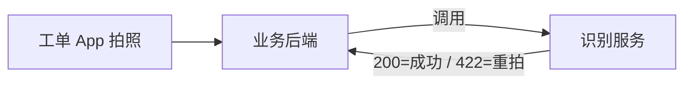
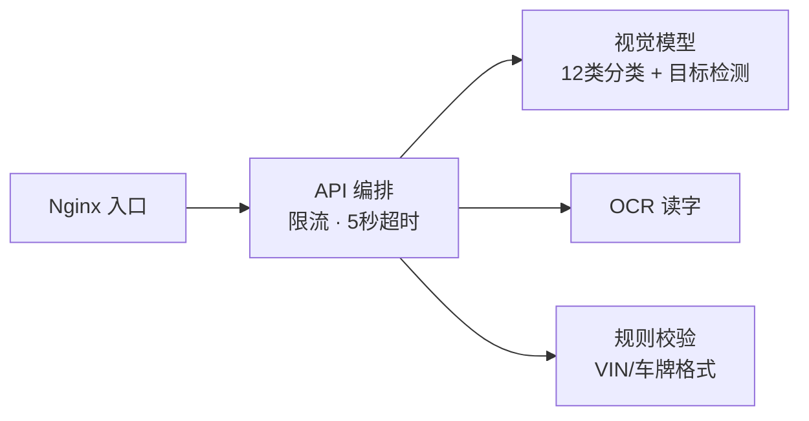
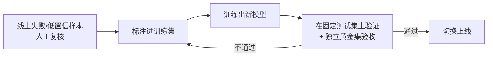

# SPM首保工单图片识别技术方案

## 一、场景说明

用户现场拍一张首保工单照片 → 告诉系统这张图是哪一类（12 种）→ 直接返回能用的信息：车牌、VIN、里程、加油/放油、有没有滤芯、签字盖章。



## 二、技术设计

### 2.1 逻辑设计

**Nginx 收流量 → FastAPI 排队限流 → 视觉模型看类别/找位置 → OCR 读字 → 规则校验 → 返回**



### 2.2 模型说明

| 用途 | 模型 |
| --- | --- |
| 认出是哪类照片（12 类：车牌、VIN、里程、桥/轮胎加油放油、滤芯、服务单…） | scene |
| 在照片里找到车牌/VIN/签字的位置 | det |
| 读出上面的字 | OCR |
| 三类油液/滤芯细分纠偏 | group / action / bin |

## 三、API 接口设计

### 3.1 请求示例

```bash
curl -X POST http://10.51.13.7:8020/v1/recognize \
  -H "X-API-Key: 你的key" \
  -F "scene=license_vin" \
  -F "image=@行驶证.jpg"

```

### 3.2 HTTP 状态码说明

| 状态码 | 意思 | 业务系统怎么做 |
| --- | --- | --- |
| `200` | 识别成功 | 直接用 `data` 里的值 |
| `422` | 这张图没识别出来 | 把 `message` 弹给现场，让他重拍或者人工处理 |
| `400` | 参数传错了 | 改代码 |
| `429` | 太忙 | 等 `Retry-After` 秒再试 |
| `5xx` | 服务挂了 | 重试一次，还不行报障 |

```json
{"scene":"license_vin","message":"识别成功","data":{"vin":"HLC3J2VEXSA603850"}}

```
```json
{"scene":"arrival_plate","message":"未识别到车牌，请靠近或正对车头重拍","data":{"plate":null}}

```

### 3.3 API场景参数说明

| scene | 用途 | data |
| --- | --- | --- |
| `arrival_plate` | 车头车牌 | `plate` |
| `license_vin` / `frame_vin` | 行驶证 / 车架 VIN | `vin` |
| `odometer` | 里程表 | `odometer` |
| `bridge_drain` / `bridge_fill` | 桥放油 / 加油 | `action` |
| `tire_drain` / `tire_fill` | 轮胎放油 / 加油 | `action` |
| `filter_none` / `filter_has` | 无滤芯 / 有滤芯 | `filter_state` |
| `service_front` | 服务单首页 VIN | `vin` / `vin_partial` |
| `service_sign` | 服务单末页 | `signature` / `stamp` |

## 四、后期迭代规划

