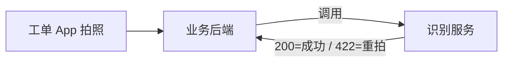
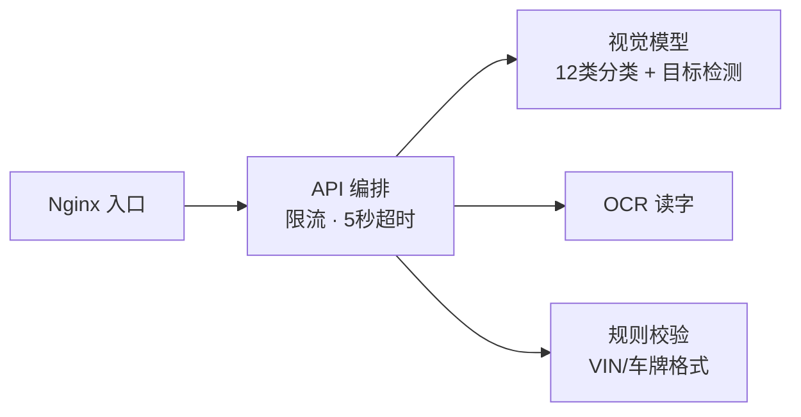
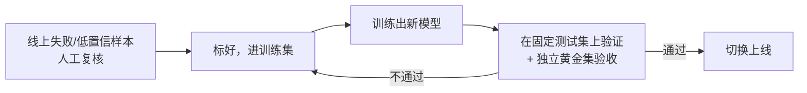

# SPM 视觉识别 · 技术方案（简明版）

## 一、它是什么

拍一张工单照片 → 告诉系统这张图是哪一类（12 种）→ 直接返回能用的信息：车牌、VIN、里程、加油/放油、有没有滤芯、签字盖章。

**只做识别，不做工单判断。** 判断 VIN 对不对、照片齐不齐，是业务系统那边的事。



## 二、怎么设计

前端一个截图就够说明：**Nginx 收流量 → FastAPI 排队限流 → 视觉模型看类别/找位置 → OCR 读字 → 规则校验 → 返回**。



用到的模型就 7 个小模型 + OCR：

| 用途 | 模型 |
|---|---|
| 认出是哪类照片（12 类：车牌、VIN、里程、桥/轮胎加油放油、滤芯、服务单…） | scene |
| 在照片里找到车牌/VIN/签字的位置 | det |
| 读出上面的字 | OCR |
| 三类油液/滤芯细分纠偏（现在**没开**） | group / action / bin_* |

**为什么小模型**：数据才几百到一千多张，大模型只会更慢、更容易过拟合。真正卡速度的是 OCR，不是模型大小。

**核心原则：宁可不放行，也不猜。** 读不到就返回 422，让现场重拍。

## 三、API 怎么用

一个接口，一张图，一个场景：

```bash
curl -X POST http://10.51.13.7:8020/v1/recognize \
  -H "X-API-Key: 你的key" \
  -F "scene=license_vin" \
  -F "image=@行驶证.jpg"
```

**看 HTTP 状态码就够了：**

| 状态码 | 意思 | 业务系统怎么做 |
|---|---|---|
| `200` | 识别成功 | 直接用 `data` 里的值 |
| `422` | 这张图没识别出来 | 把 `message` 弹给现场，让他重拍 |
| `400` | 参数传错了 | 改代码 |
| `429` | 太忙 | 等 `Retry-After` 秒再试 |
| `5xx` | 服务挂了 | 重试一次，还不行报障 |

**返回长这样：**

```json
{"scene":"license_vin","message":"识别成功","data":{"vin":"HLC3J2VEXSA603850"}}
```

```json
{"scene":"arrival_plate","message":"未识别到车牌，请靠近或正对车头重拍","data":{"plate":null}}
```

**12 个 scene 和对应的 data 字段：**

| scene | 用途 | data |
|---|---|---|
| `arrival_plate` | 车头车牌 | `plate` |
| `license_vin` / `frame_vin` | 行驶证 / 车架 VIN | `vin` |
| `odometer` | 里程表 | `odometer` |
| `bridge_drain` / `bridge_fill` | 桥放油 / 加油 | `action` |
| `tire_drain` / `tire_fill` | 轮胎放油 / 加油 | `action` |
| `filter_none` / `filter_has` | 无滤芯 / 有滤芯 | `filter_state` |
| `service_front` | 服务单首页 VIN | `vin` / `vin_partial` |
| `service_sign` | 服务单末页 | `signature` / `stamp` |

**业务系统要记住三件事：**

1. 一次一张，一个工单 10 张图就调 10 次，失败重拍是新的一次请求。
2. `422` 别用原图重试，一定是图不行。
3. 跨图校验（VIN 是否一致、四件套齐不齐）自己在这边做。

**性能（当前实测）**：油液/滤芯/签章类 0.1–0.3s；车牌/VIN/里程 1–2s；单张最多 5s 返回，超时就是 422。

## 四、上线后怎么迭代

**每轮迭代都是同一条流水线：**



**路线：**

| 阶段 | 时间 | 干什么 | 达到什么 |
|---|---|---|---|
| P0 | 2 周 | 补限流/超时/错误码，搭监控和日志 | 能定位问题、出问题能回滚 |
| P1 | 6 周 | 把线上识别结果和人工复核结果存下来 | 能算出真实准确率，能灰度发布 |
| P2 | 10 周 | 扩 OCR、扩标注、重训模型 | 32 并发下稳定、文本类变准 |
| P3 | 下半年 | 多调用方、多机部署 | 不再单点，能接全量 |

**迭代节奏建议**：模型每月出一次候选，验证通过才上线；应用两周一个小版本。

## 五、现在最大的三个坑

| 问题 | 后果 | 先怎么处理 |
|---|---|---|
| 低置信结果没拦住，可能把错值当对的返回 | 错 VIN 进工单，比让现场重拍贵得多 | 加置信度门槛，低置信一律 422 |
| OCR 扛不住 32 并发 | 高峰期大面积超时 | 加 OCR 进程，或上专用识别模型 |
| 线上请求没落库，只有日志 | 算不出真实准确率，没法证明模型越改越好 | 先存请求+人工复核结果 |

## 六、上线前必须做的

1. 配 `API_KEYS`，按调用方发 key。
2. 在 L20 服务器上压测 32 并发，确认 P95 达标。
3. 挑 300 张图，人工双标当验收集。
4. 演练一次模型回滚。
5. 和业务方对一遍 422 的提示文案。

---

> 详细版看 [技术方案-落地与迭代规划.md](技术方案-落地与迭代规划.md)。