# SPM 视觉识别 · 落地技术方案与迭代规划

> 文档版本：v1.0（评审稿）  
> 日期：2026-11-24  
> 代码基线：`spmcv` app `v3.0` / 模型 `v5.1.0` / 138 个测试用例  
> 适用读者：研发、算法、运维、业务接口人、项目负责人  
> 关联文档：[对外 API 文档](SPM图片ai识别API文档.md) · [部署方案](部署方案.md) · [部署更新手册](部署更新手册.md) · [上线方案](上线方案.md) · [模型生命周期](model_lifecycle.md)

---

## 阅读指引

| 读者 | 先读 | 重点关注 |
|---|---|---|
| 项目负责人 / 业务 | 第 0、1、12 章 | 能不能上线、还差什么、什么时候到什么程度 |
| 后端 / 平台研发 | 第 2、3、4、5 章 | 架构、训练与发布、接口限流、部署 |
| 算法 | 第 2.3、2.7、3.1–3.5 章 | 模型清单、优化路线、数据与验收口径 |
| 运维 / SRE | 第 3.6–3.8、4.4、5 章 | 日志、告警、容量、打包回滚 |
| 测试 / 业务验收 | 第 9、10、11 章 | 测试用例、CR、上线检查清单 |

**四个问题对应的章节：**

| 你的问题 | 看哪里 | 一句话答案 |
|---|---|---|
| 整体技术设计、哪些模型、后期怎么优化 | 2.1–2.7 | 7 个视觉头 + OCR + 规则级联；先修阈值/数据/OCR，再动模型结构 |
| 怎么训练、模型怎么管/怎么切、线上数据怎么收、日志怎么定位 bug | 3.1–3.8 | 工单分组切分 → 候选 → 四项门禁 → reload/回滚；事件表 + 采样复核 + 结构化日志 |
| 接口怎么设计、并发限流怎么做 | 4.1–4.7 | 单接口单图；三层限流；OCR 是当前容量瓶颈，先扩 OCR 再谈 QPS |
| 项目怎么打包部署 | 5.1–5.7 | 四容器 Compose + tar 包 + update.sh + 契约验收 + 回滚 |
| 后续怎么迭代 | 13.1–13.6 | P0 加固 2 周 → P1 数据闭环 6 周 → P2 精度/性能 10 周 → P3 规模化 |

**与 PRD 技术方案模板的对应：**

| 模板项 | 本文 | 模板项 | 本文 |
|---|---|---|---|
| 业务逻辑 | 第 1 章 | 日志告警规划 | 3.7–3.8 |
| DDL | 第 7 章 | 代码注释 | 第 8 章 |
| 接口 | 第 4 章 | 任务拆分 | 第 9 章 |
| 数仓关联 | 第 6 章 | 测试用例 | 第 10 章 |
| Coding 规范 | 第 8 章 | CR & Showcase | 第 11 章 |
| 上线 LIST | 第 12 章 | 后续迭代 | 第 13 章 |

> 文中带 `✅` 的是代码里已经有的，`⚠️` 是已有但不完整，`🧭` 是本文提出的规划。所有性能与准确率数字都注明口径，不把“场景分类 OOF”当成“整单通过率”。  
> 图表使用 Mermaid：GitHub、VS Code（Mermaid 预览）、Typora、语雀可直接渲染；不支持 Mermaid 的平台会显示为代码块，需先导出为图片。

---

## 0. 一页结论

### 0.1 一句话判断

**当前系统已经具备“单图 12 场景识别 + 模型可追溯回滚 + 可重复部署”的试点能力，可以在内网、单调用方、带人工复核的条件下上线试点；距离“全量、可运营”还差三件事：OCR 并发容量、线上数据闭环、可观测与灰度发布。**

### 0.2 现状盘点

| 维度 | 现状 | 证据 | 结论 |
|---|---|---|---|
| 接口 | 对外只有 `POST /v1/recognize`，单图 + 12 场景，`200` 成功 / `422` 不成功 | `app/api/recognize.py` | ✅ 契约简单，适合上游编排 |
| 模型 | 7 个推理头 + OCR；scene 为 v5.1.0，group/action/bin/det 沿用 v5.0.0 | `models/registry.json` | ⚠️ 版本混搭，融合开关必须保持关闭 |
| 精度 | 场景 5 折工单隔离 OOF **86.98%**（1136/1306），新域 **82.21%**（624/759） | `README.md`、`registry.json` | ⚠️ 不等于整单准确率，缺独立黄金集 |
| 性能 | 单发实测 P50 **232ms**、Max **4513ms**；快路径 32 并发 P95 **1.9s**；OCR 路径 16 并发 P95 **5.6s** | `final_plan_20261120.md` | ⚠️ 文本类是瓶颈，32 并发未达标 |
| 发布 | 注册表 + sha256 manifest + 四项 evidence 门禁 + `activate` | `scripts/models.py`、`deploy/README.md` | ✅ 发布纪律好；缺灰度与自动回滚 |
| 数据 | 上传批次 → 自动标注 → 人工改标（SQLite）→ 按工单 70/15/15 构建数据集 | `feedback_store.py`、`datasets.py` | ⚠️ 只有离线标注，没有线上反馈闭环 |
| 可观测 | `X-Request-Id`、访问日志、`/metrics`（P50/P95）、`/healthz`、`/readyz` | `obs.py`、`metrics.py`、`health.py` | ⚠️ 缺阶段耗时、缺标签、缺告警、缺决策快照 |
| 部署 | 单机 Docker Compose（api/vision/ocr/nginx）+ tar 升级包 + 契约验收 | `deploy/` | ⚠️ 可重复但无 HA，单 GPU/单机是硬约束 |
| 安全 | API Key（默认空）、可选 SSO、CORS `*`、URL 拉取无域名白名单 | `obs.py`、`image_fetch.py` | ⚠️ 对外前必须收紧 |

### 0.3 代码级审计发现（按严重度）

| # | 发现 | 位置 | 影响 | 处理阶段 |
|---|---|---|---|---|
| A1 | **复核规则未接入新接口**：油液/滤芯只看类别是否相等，不用置信度；文本类忽略 `_character` 返回的 `need_review`（VIN 校验位、车牌新能源末位），低置信/需复核也会 `200` | `recognizer.py::_recognize_oil`、`_recognize_text` | 误放行；与 README“低置信需复核”不一致 | P0 |
| A2 | 接口内的 `400/413/422` 返回 `{scene,message,data}`，中间件/参数校验返回 `{code,message,request_id,…}`；**同一状态码两种结构** | `recognize.py` vs `obs.py` | 上游按 `data` 解析会拿到 `None`，错误处理分叉 | P0 |
| A3 | 经 Nginx 的请求没有 `X-Forwarded-For`，应用取到的是 Nginx 容器 IP，**所有调用方共用一个限流桶** | `deploy/nginx.conf`、`admission.py::_client_of` | 单调用方可打满全局额度，多调用方互相影响 | P0 |
| A4 | API Key 校验在 `obs` 中间件，`admission` 更靠外层，**未鉴权请求先占并发槽/限流桶再被 401**；429 的 `request_id` 也因此取不到（为 `-`） | `app/main.py` 中间件顺序 | 无效流量消耗入口容量；限流/拒绝无法关联日志 | P0 |
| A5 | URL 下载固定 3s 预算，OCR 固定 2.5s 预算，**没有把剩余 deadline 传下去**；慢下载后 OCR 仍按固定预算跑 | `recognize.py`、`ocr_service.py` | 调用方能在 5s 拿到 422，但下游线程继续占用 OCR，容量被慢请求吃掉 | P0 |
| A6 | `asyncio.wait_for` 取消的是协程，**线程池里的 OCR 推理不能取消** | `asyncio.to_thread` 用法 | 超时后 OCR 线程仍可能在后台跑到客户端超时（6s），容量被“幽灵请求”吃掉 | P1 |
| A7 | `/metrics` 是进程内 500 样本窗口，无 `scene/code/model_version` 标签，无下游耗时 | `metrics.py` | 只能看全局，无法定位“哪个场景、哪个版本、哪一段”变慢 | P0 |
| A8 | `image_url` 只校验 http/https，**无域名/网段白名单** | `image_fetch.py` | SSRF：可探测内网元数据、管理口 | P0 |
| A9 | 训练状态、限流桶、准入信号量都在 API 进程内，**API 只能单 worker** | `Dockerfile.api` 注释 | 横向扩容会让并发上限和限流值翻倍 | P1 |
| A10 | 文档口径不一致：`models/README` 写“切版本 = 改软链 + 重启”，`部署方案.md` 写“热加载不用重启”；代码两者都支持（`/v1/reload` 失败时保留旧权重并提示重启） | `docs/部署方案.md`、`models/README.md`、`vision_service.py::/v1/reload` | 运维按不同文档操作会误判 | P1 |

> A1–A5、A7、A8 是 P0 要修的项；A6、A9、A10 放 P1。**不建议跳过 A1 试点**：没有置信度/复核标记，人工复核不知道重点看哪张。若因时间压力必须并行，至少先加“低置信打标 + 人工抽查”，并且只开放单调用方。

### 0.4 关键决策

| # | 决策点 | 选择 | 理由 |
|---|---|---|---|
| D1 | 接口形态 | 单接口、单图、单场景；**不做工单比对** | 上游已有工单编排；服务保持无状态、易扩容、契约稳定 |
| D2 | 模型组织 | 场景头 + 属性/动作头 + 检测器 + OCR，多模型级联 | 每层可独立评估、独立替换；避免一个大模型不可解释 |
| D3 | 低置信处理 | **宁可不放行，也不猜**；低置信映射为 `422` + 可执行提示 | 误放行（错值进工单）成本远高于让现场重拍 |
| D4 | 发布方式 | 注册表 + manifest 哈希 + 四项 evidence 门禁；先 `candidate` 再 `active` | 可追溯、可回滚；禁止“训练完直接上线” |
| D5 | 限流 | 三层：Nginx 粗限流 → 应用内每调用方限流 → 全局准入信号量 | 当前单 worker 下最简单有效；扩容前把前两层外置 |
| D6 | 部署 | 单机 Compose + tar 包（离线内网）；后续补镜像仓库与双副本 | 当前环境以堡垒机+内网为主，tar 最省事 |
| D7 | 数据闭环 | 先做“识别事件日志 + 采样复核”，再做上游 `biz_id` 与审计结果回流 | 不改契约即可上线；真值回流需要上游配合 |

### 0.5 上线判断

| 场景 | 结论 | 前置条件 |
|---|---|---|
| 内网试点（1 个调用方、日几千张） | ✅ 可以 | 配 `API_KEYS`、修 A1–A5、人工复核兜底、值班到位 |
| 多调用方共用（3 个以上） | ⚠️ 谨慎 | 修 A3/A4、按调用方配额、压测 32 并发 |
| 全量生产（无人工复核） | ❌ 暂不建议 | 独立黄金集、误放行阈值、线上反馈闭环、灰度与自动回滚 |

---

## 1. 业务逻辑与范围

### 1.1 业务链路

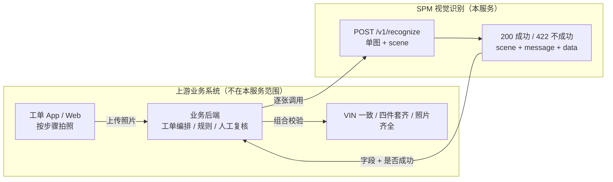

**职责边界：**

- 本服务回答两个问题：**这张图在指定 `scene` 下能不能识别成功？识别出的字段是什么？**
- 本服务**不**判断工单是否合格、**不**跨图比对 VIN、**不**要求四件套齐全、**不**保存工单。
- 上游拿到单张结果后自行组合；这样本服务可以无状态、水平扩展、按图计费。

### 1.2 12 个场景与判定语义

| 分组 | scene | 含义 | `200` 条件 | `data` |
|---|---|---|---|---|
| 油液/滤芯 | `bridge_drain` / `bridge_fill` | 桥放油 / 桥加油 | 12 类头输出与 scene 一致 | `action` = `drain` / `fill` |
| 油液/滤芯 | `tire_drain` / `tire_fill` | 轮胎放油 / 轮胎加油 | 同上 | `action` |
| 油液/滤芯 | `filter_none` / `filter_has` | 无滤芯 / 有滤芯 | 12 类头输出与 scene 一致 | `filter_state` = `none` / `has` |
| 文本 | `arrival_plate` | 车头及车牌号 | 读到车牌（新能源末位 D/F 校验 P0 接入） | `plate` |
| 文本 | `license_vin` | 行驶证 VIN | 读到 17 位 VIN（校验位 P0 强制） | `vin` |
| 文本 | `frame_vin` | 车架贴牌 VIN | 同上 | `vin` |
| 文本 | `odometer` | 里程表 | 读到总里程数字 | `odometer`（number） |
| 文本 | `service_front` | 服务单首页 VIN | 读到完整 VIN，或仅尾段且可定位 | `vin` / `vin_partial` |
| 签章 | `service_sign` | 服务单末页 | 客户签字与服务站盖章**都**检测到 | `signature` / `stamp` |

**判定只看 HTTP 状态码**：`200` = 本场景识别成功；`422` = 不成功（`message` 可直接给现场看，提示重拍）。`400/413` 是请求本身有问题，`429` 是限流，`5xx` 是服务异常。

> 注意：`422` 同时承载“识别不成功”和“参数校验失败”两种语义；`400/413` 在接口内也被包装成 `{scene,message,data}`。这是 A2 的根源。P0 会在业务错误里补 `code` 与 `request_id`，并保持 `scene/message/data` 兼容。

### 1.3 三条产品红线

1. **不编造**：字段读不到就返回 `null` + `422`，不用上下文猜、不用相邻行补。服务单首页只读到尾段时返回 `vin_partial` 并提示重拍，这是设计行为。
2. **不做跨图/工单推断**：同一工单的 VIN 冲突、油液方向冲突由上游规则处理；本服务只对单图负责。
3. **复核优先**：置信度不足、字段校验不过、多模型冲突时，宁可 `422` 让现场重拍，也不返回一个“看起来对”的值。

### 1.4 成功指标（SLO 建议）

| 指标 | 定义 | 试点目标 | 全量目标 | 现状 |
|---|---|---|---|---|
| 可用性 | 非 5xx 请求 / 总请求 | ≥ 99.5% | ≥ 99.9% | 未统计 |
| 单发延迟 | 单张、低并发 P95 | ≤ 2.5s | ≤ 2.0s | P50 232ms，Max 4.5s |
| 并发延迟（快路径） | 32 并发、油液/滤芯/签章 P95 | ≤ 2.5s | ≤ 2.0s | 1.9s |
| 并发延迟（文本路径） | 32 并发、车牌/VIN/里程 P95 | ≤ 5.0s（P0 过渡） | ≤ 3.0s | 16 并发 5.6s（32 并发未测） |
| 硬截止 | 超过 `REQUEST_DEADLINE_S=5` 的比例 | ≤ 1% | ≤ 0.5% | 未统计 |
| 限流误伤 | 正常流量被 429 的比例 | ≤ 0.5% | ≤ 0.1% | 未统计 |
| 单图识别成功率 | `200 / (200+422)`，按 scene 分 | 建立基线 | 按场景定目标 | 缺黄金集 |
| 误放行率 | 返回 `200` 但字段错 / `200` 总数 | 人工复核兜底 | ≤ 1%（业务确认） | 未度量 |
| 复核率 | 需人工确认 / 总数 | 建立基线 | 逐季下降 | 未度量 |
| 定位时长 | 从告警到定位到 request_id | ≤ 30min | ≤ 15min | 无告警 |

> “场景分类 OOF 86.98%”是**模型在折外数据上的分类准确率**，不是单图字段准确率，更不是整单通过率。三者必须分开报。

---

## 2. 整体技术设计

### 2.1 系统架构

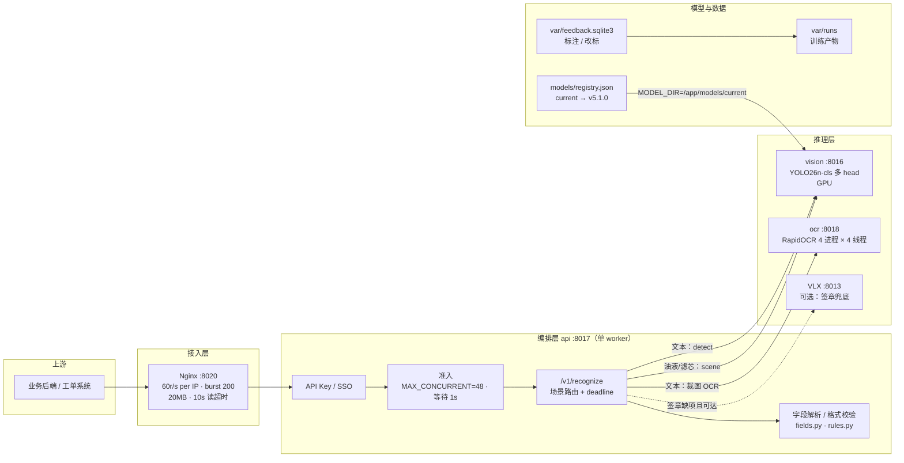

**端口与进程视图：**

| 服务 | 端口 | 进程/并发 | 有状态？ | 说明 |
|---|---|---|---|---|
| nginx | 8020 → 80 | 多 worker | 否 | 入口、粗限流、静态资源 |
| api | 8017 | **1 worker**（刻意） | 是（信号量/限流桶/训练状态） | 编排、鉴权、准入、规则 |
| vision | 8016 | 1 进程 + 每 head 一把锁 | 是（权重常驻显存） | 分类/检测 |
| ocr | 8018 | 4 worker × 4 线程 | 是（引擎常驻） | 文本识别 |
| VLX | 8013 | 外部服务 | — | 仅签章兜底，默认不依赖 |

> API 单 worker 不是偷懒：准入信号量、限流桶、`/metrics` 窗口、训练任务句柄都是进程内状态，多 worker 会让“全局 48 并发”变成“每 worker 48”。要扩容 API，先把这些状态外置（见 P1）。

### 2.2 组件职责

| 组件 | 代码 | 职责 | 不做什么 |
|---|---|---|---|
| 接入 | `deploy/nginx.conf` | TLS 终止（规划）、粗限流、请求体上限、超时兜底 | 不做业务判定 |
| 鉴权 | `app/obs.py`、`app/sso.py` | API Key / 统一登录、`request_id`、统一错误结构 | 不做细粒度权限 |
| 准入 | `app/admission.py` | 每调用方限流、全局并发上限、快速 429 | 不排队到超时 |
| 编排 | `app/api/recognize.py`、`app/services/recognizer.py` | 场景路由、deadline、降级、响应组装 | 不做工单规则 |
| 视觉 | `app/services/vision_service.py` | 12 类场景、3 类分组、6 类动作、二分类、18 类检测 | 不做 OCR |
| OCR | `app/services/ocr_service.py` | 裁图/整图文本、角度重试、车牌重建 | 不做场景判定 |
| 规则 | `app/services/fields.py`、`rules.py` | VIN 校验、车牌格式、里程范围、字段清洗 | 不做模型推理 |
| 模型注册 | `scripts/models.py`、`models/registry.json` | 冻结、哈希校验、门禁、激活、回滚 | 不训练 |
| 数据 | `app/services/datasets.py`、`feedback_store.py` | 批次、去重、按工单切分、人工改标 | 不做线上反馈（规划） |

### 2.3 模型清单

| 角色 | 权重 | 架构 | 类别 | 当前版本 | 指标（口径） | 用途 |
|---|---|---|---|---|---|---|
| `scene` | `scene.pt` | YOLO26n-cls | 12 | **v5.1.0** | 5 折 OOF 86.98%；新域 82.21%；top5 99.6% | 场景/油液/滤芯判定 |
| `group` | `group.pt` | YOLO-cls | 3（桥/轮胎/滤芯） | v5.0.0 | top1 95.56%，覆盖 82.22% | 油液分组纠偏（融合关闭时不参与） |
| `action` | `action.pt` | YOLO-cls | 6 | v5.0.0 | top1 88.89%，覆盖 73.33% | 动作细化（融合关闭时不参与） |
| `bin_axle` | `bin_axle.pt` | YOLO-cls | 2 | v5.0.0 | 100%（n=13，小样本） | 桥加/放油二分类 |
| `bin_tire` | `bin_tire.pt` | YOLO-cls | 2 | v5.0.0 | 100%（n=19，小样本） | 轮胎加/放油二分类 |
| `bin_filter` | `bin_filter.pt` | YOLO-cls | 2 | v5.0.0 | 100%（n=13，小样本） | 有/无滤芯二分类 |
| `det` | `det.pt` | YOLO 检测 | 18 | v5.0.0（未随 v5.1 重训） | det_v2 候选 200 张，签字框 10→69 | 车牌/VIN/里程/签章定位 |
| OCR | RapidOCR | PP-OCR 系 | — | 镜像内 | 车牌/VIN/里程 | 文本识别 |
| VLX | 外部 | 视觉大模型 | — | 8013 | 签章兜底实测 22/34→33/34 | 仅 `service_sign` 缺项 |
| KEV | 外部 | 4B pointer head | — | 10.51.13.7:8008 | 只吃文本 | 油类/证据仲裁，默认 `off` |

**场景 → 模型映射：**

| 场景组 | 主链路 | 辅助/兜底 | 明确不用的 |
|---|---|---|---|
| 油液/滤芯（6 个 scene） | `scene` 12 类头 | `group`/`action`/`bin_*` 仅在融合开启时参与；当前关闭 | 检测器、OCR |
| 文本（车牌/VIN/里程/首页） | `det` 定位 ROI → `ocr` 裁图识别 → 字段/规则校验 | 角度重试、车牌重建；scene 头不参与 | `action`/`bin_*` |
| 签章（`service_sign`） | `det` 检测签字/盖章框 + 阈值 | VLX 仅在缺项且可达时兜底 | OCR、scene 头 |

**选型理由（为什么是这些模型）：**

| 任务 | 当前选择 | 主要备选 | 选择理由 | 何时换 |
|---|---|---|---|---|
| 场景分类 | YOLO26n-cls @512 | ResNet50 / EfficientNet-B0 / ViT / CLIP | 数据量小（537–1306 张）、延迟敏感、部署简单；v5 在 537 张上 5 折均值 94.60%±1.82% | 数据 >5k 且轻量模型饱和时，再试 ViT/蒸馏 |
| 目标检测 | YOLO 18 类 | RT-DETR / GroundingDINO / DETR | 需要实时、可离线、标注框少；YOLO 生态成熟、导出 ONNX/TensorRT 方便 | 开放词表/零样本需求出现时 |
| OCR | RapidOCR（PP-OCR 系） | PaddleOCR GPU / 云 OCR / VLM | 内网 CPU 可跑、无外部依赖、成本低；精度靠裁图+多角度+规则补 | 文本类仍是瓶颈且 GPU 有余量时 |
| 签章 | 检测器 + 阈值 | 纯 VLM 判定 | VLM 单次 +2–7s，成本高；检测器毫秒级，缺项再兜底 | 检测器召回长期上不去时 |
| 融合纠偏 | group/action 头 | 纯规则 / 单 scene 头 | 多模型交叉验证可降误判，但必须先同源重训 | 7 头同版本 + 黄金集验收后 |

> 模型不是越大越好：当前数据规模下，大模型主要增加延迟和过拟合风险；瓶颈在 OCR 与数据质量，不在 backbone 容量。

**必须遵守的模型约束：**

1. 一个版本的 7 个头必须**同时产出**，禁止 scene v5.1 配 action v5.0 开融合；当前 `ENABLE_FUSION=0` 是正确状态。
2. `bin_*` 指标样本量只有 13–19 张，不能当作稳定精度；上线前要用黄金集复核。
3. `det` 仍是旧权重，文本类上限由检测框质量决定；det_v2 只是候选，未完成全量验收。
4. VLX 只做签章兜底，不参与常规判定；不可达时必须能无感降级。

### 2.4 单请求时序与延迟预算

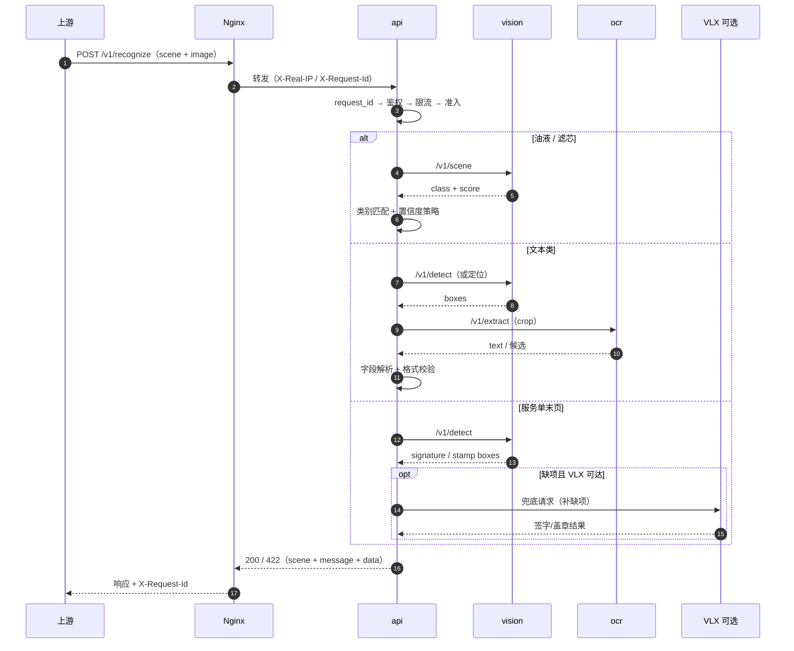

**延迟预算（目标值，不是承诺值）：**

| 阶段 | 快路径（油液/滤芯/签章） | 文本路径 | 预算上限 | 说明 |
|---|---|---|---|---|
| 接入/校验/鉴权 | 5–20ms | 5–20ms | 50ms | 含 magic bytes 校验 |
| 预处理 | 0（正常图） | 0–50ms | 100ms | 仅 8.5% 背光图触发 gamma |
| 场景分类 | 100–250ms | 已知 scene 不做 | 500ms | 文本类直接进检测 |
| 检测/定位 | 100–300ms | 100–300ms | 800ms | 文本类必需 |
| OCR | — | 600–2000ms | 2500ms | 含角度/车牌重试 |
| 规则/组装 | ≤20ms | ≤20ms | 50ms | VIN/车牌/里程校验 |
| 余量 | — | — | 500ms | 抖动与排队 |
| **合计** | **0.1–0.6s** | **1–3s** | **5s 硬截止** | 超时返回 `422` |

```text
0ms      500     1000     1500     2000     2500     3000     3500     4000     4500    5000
|---------|---------|---------|---------|---------|---------|---------|---------|--------|-----|
[接入 20ms][预处理 ≤50ms][检测 100-300ms][OCR 600-2000ms][重试/余量 .................][硬截止]
```

**超时链路必须满足：** `Nginx 10s > API 5s > OCR 2.5s + 检测 0.8s + 余量`。当前 URL 路径是 `下载 3s + OCR 2.5s + 检测 0.3s ≈ 5.8s`，已经超过 5s（A5）。P0 改为**把剩余预算传给 OCR**（`X-Budget-Ms` 或表单字段），而不是固定 2.5s。

### 2.5 场景路由与判定

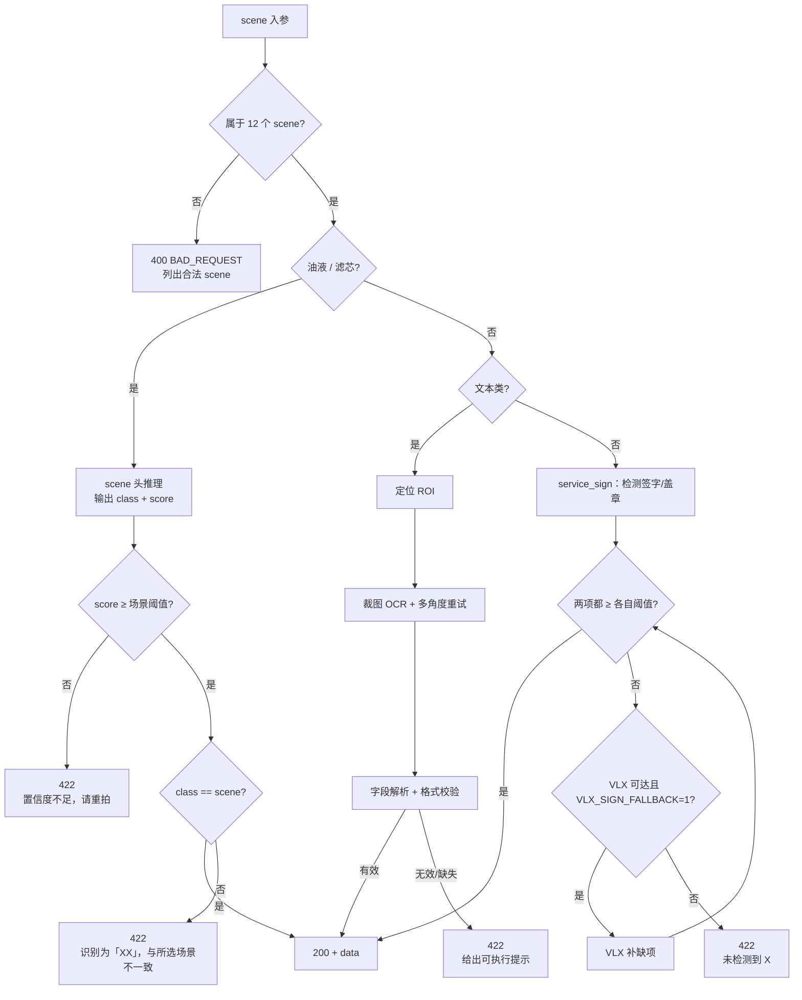

**关键策略：**

- **已知 scene 不走 12 类分类**：文本类直接检测+OCR，省 150–400ms；代价是“用户选错 scene”时只能靠字段校验发现。
- **文本类当前只看字段是否存在**：`_character` 已经算出 `need_review`（VIN 校验位、车牌末位、尾段 VIN），但 `/v1/recognize` 没有消费；P0 把高风险项（VIN 校验失败、车牌末位不合规）映射为 `422`，低风险项先以 `200 + need_review` 过渡，禁止静默放行。
- **油液/滤芯的 12 类输出既是场景也是动作**：这是当前分类法把“动作”编码进“场景”的结果，也是标签噪声的来源之一（见 2.7）。
- **融合默认关闭**：`ENABLE_FUSION=0`。group/action 头与 scene 头不是同一版数据训练，开融合会把对的改错；等 7 头同源重训 + 黄金集验收后再开。
- **签章阈值很低**（0.10 / 0.25）：检测器召回不足时的妥协，误检风险由“两项都要有”+ 人工复核兜底；P1 用 det_v2 + 黄金集重新校准。

### 2.6 关键取舍（ADR）

| 决策 | 选择 | 替代方案 | 代价 | 何时需要重新评估 |
|---|---|---|---|---|
| 单接口 vs 工单接口 | 单图单 scene | `/v1/workorder` 一次多图 | 上游要自己编排、失败重试逻辑在上游 | 上游明确不愿编排，或跨图规则成为瓶颈 |
| 同步 vs 异步 | 同步 5s 硬截止 | 提交任务 + 轮询/回调 | 长尾请求只能 422；无法批处理 | 批量补录、离线跑批需求出现 |
| 已知 scene 不分类 | 跳过 scene 头 | 每张都先分类再校验 | 选错 scene 时浪费一次 OCR | 上游 scene 不可信，或错选率高 |
| 规则在服务内 | 只做字段格式/范围 | 全部规则上游做 | 上游要理解 VIN/车牌格式 | 上游已有成熟校验，可下沉 |
| 模型热加载 | `/v1/reload` + 锁 | 重启容器 | reload 期间推理被锁阻塞数百 ms–数 s | 有双副本/双卡可做蓝绿 |
| 单 API worker | 保留 | 多 worker | 吞吐受限，无法滚动升级 | 需要 >10–15 QPS 或零停机 |
| 融合关闭 | 只用 scene 头 | 开 group/action 纠偏 | 少 1–2pt 覆盖 | 7 头同源重训并通过黄金集 |

### 2.7 后期优化路线（模型侧）

优化顺序的原则：**先修评估口径和数据，再动模型结构；先做低风险高收益，再做重训练。**

| 优先级 | 方向 | 具体动作 | 预期收益 | 成本 | 风险 |
|---|---|---|---|---|---|
| P0 | 阈值与校准 | 按 scene 统计 score 分布，给油液/滤芯加最小置信度；温度缩放校准 | 直接降低误放行 | S | 阈值过高 → 复核率上升 |
| P0 | 7 头同源 | 用同一数据快照重训 group/action/bin/det，产出单一 bundle | 融合可开，+1–2pt 覆盖 | M | 训练/验收工作量大 |
| P1 | 黄金集 | 按工单抽 300–500 张，覆盖 12 场景 × 新老域 × 背光/模糊 | 所有指标有真值 | M | 标注人力 |
| P1 | 分类法解耦 | 内部改为“部件（桥/轮胎/滤芯/文本/签章）+ 属性（加/放/有/无）”，对外仍映射 12 scene | 标签噪声下降，油液 +3–5pt | L | 需改训练/推理映射，契约不变 |
| P1 | 检测器扩样 | det_v2 从 200 张扩到 1500+，补车牌/VIN/里程/签章四类框 | 文本类 +2–3pt | M | 标注成本 |
| P2 | OCR 专项 | 车牌专用识别、VIN 字符集约束、里程数字后处理 | 文本类 +1–3pt，延迟 −20% | M | 需要合成/真实难例 |
| P2 | 推理加速 | ONNX Runtime / TensorRT FP16；分类头批处理 | 延迟 −30–50%，吞吐 ×2 | M | 精度略降，需回归 |
| P2 | 预处理学习化 | 用轻量曝光校正替代固定 gamma；只在高价值场景开 | 背光图 +2–5pt | S | 可能引入色彩偏差 |
| P3 | 多任务/蒸馏 | 一个 backbone 多头，或大模型蒸馏到小模型 | 维护成本下降 | L | 迭代周期长 |

**不建议现在做的：**

- 直接上更大的视觉大模型做全场景判定：延迟 +2–7s，成本高，且当前瓶颈在 OCR 和数据，不在 backbone 容量。
- 打开融合“试试看”：版本不对齐，A/B 结论不可信。
- 用线上未复核数据直接训练：标签噪声会把已有 86.98% 拉低。

---

## 3. 训练、模型管理与数据闭环

### 3.1 训练数据流水线

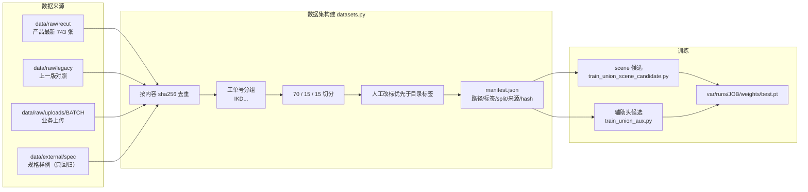

**数据规则：**

1. **切分单位是工单，不是单张图**。同一工单的照片必须落在同一个 split，否则“同一辆车既在训练又在测试”，指标虚高。
2. **人工改标优先于目录标签**；`evidence_status != visible`、`other`、`uncertain` 的记录保留审计但不进监督集。
3. **按内容 sha256 去重**，重复上传只留一份；manifest 记录每张图的 `split/label/order/origin/sha256/相对路径`。
4. **相对软链**，换机/换挂载点不需要重建数据集。
5. **测试集只用于验收**，不能拿来调参、调阈值、选模型。

### 3.2 三种评估口径，不能混着报

| 口径 | 做法 | 回答什么问题 | 当前状态 | 用途 |
|---|---|---|---|---|
| 单折 hold-out | fold-0，107 张 | 这一折上大概多少 | v5 场景 top1 95.33% | 快速迭代参考 |
| 5 折工单隔离 OOF | 94 个工单切 5 折，每折独立训练 | 泛化到未见工单的能力 | **86.98%**（1136/1306） | 模型选型/版本对比 |
| 独立黄金集 | 300–500 张，人工双标+仲裁，锁定版本 | 真实业务准确率/误放行 | **尚未建立** | 上线门禁/对外承诺 |
| 整单通过率 | 上游按工单组合后的最终结果 | 业务价值 | 未度量 | 业务汇报 |

**黄金集建议规格：**

- 300–500 张，按工单抽，覆盖 12 场景 × 新域/老域 × 正常/背光/模糊/旋转；
- 每张两人独立标注，冲突仲裁；记录 `label / evidence_status / 可接受替代值`；
- 锁定后只增不减，版本化（`golden_v1`）；每次发布跑同一套，报告留档；
- 业务方确认“误放行”与“复核”的成本权重，写入验收文件，而不是由算法单方面定阈值。

### 3.3 训练执行

| 方式 | 入口 | 适用 | 注意 |
|---|---|---|---|
| 页面/接口 | `POST /viz/api/train/start`，`GET /viz/api/train/status` | 日常迭代，不想登服务器 | 同一时间只允许 1 个任务；训练完成不自动上线，人工确认后再 freeze 为 candidate |
| 脚本（推荐可复现） | `make train-scene-candidate ARGS='--folds 0,1,2,3,4 ...'` | 正式候选、需要完整 OOF | 权重只写 `var/runs/`，不改 `models/current` |
| 辅助头 | `python scripts/train_union_aux.py --folds ...` | group/action/bin 候选 | 必须与 scene 用同一数据快照 |

**训练环境约束：**

- 生产 GPU 同时承担在线推理，**训练会抢显存和算力**。正式训练安排在低峰期或独立卡；不要在白天全量训练。
- 训练设备 `TRAIN_DEVICE=auto|cuda|mps|cpu`；CPU 训练只用于冒烟。
- 每次候选必须记录：数据 manifest SHA、折分 SHA、git commit、超参、随机种子、环境版本；缺一项就无法复现，不能进发布门禁。
- 训练完成后自动在**独立 test split** 上评估，写 `test.json`；没有 test 结果的候选不能作为上线依据。

### 3.4 模型注册与版本管理

```text
models/
  registry.json          # 版本索引：状态/指标/创建时间/manifest 指纹
  current -> v5.1.0      # 软链，服务只认这个
  v5.1.0/
    manifest.json        # 每个文件 sha256 + 来源 + 指标
    weights/*.pt         # 7 个头
    onnx/*.onnx          # 可选，推理镜像用
```

**状态机：**

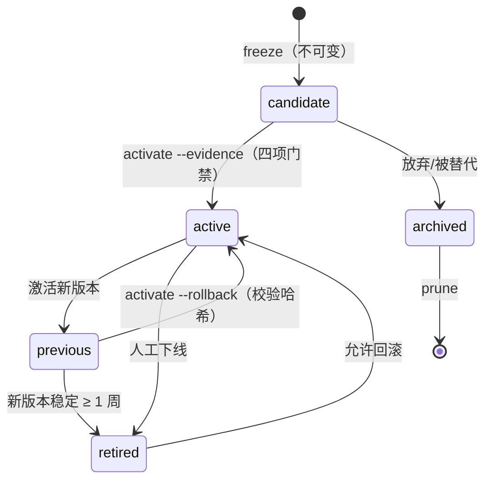

| 状态 | 含义 | 谁在用 | 允许操作 |
|---|---|---|---|
| `candidate` | 刚冻结，未验收 | 没人 | 评估、补证据、放弃 |
| `active` | `current` 指向它 | 线上 | 回滚、被新版本替换 |
| `previous` | 上一个 active | 回滚目标 | 回滚为 active |
| `retired` | 明确下线 | 没人 | 仅回滚 |
| `archived` | 淘汰 | 没人 | `prune` 删除 |

**命令：**

```bash
# 1) 冻结候选（版本目录不可变，禁止覆盖）
python scripts/models.py freeze v5.2.0 --from var/runs/xxx --metrics docs/reports/metrics_v52.json

# 2) 校验哈希
python scripts/models.py verify --version v5.2.0

# 3) 带验收证据激活
python scripts/models.py activate v5.2.0 --evidence docs/reports/v5.2.0_release.json

# 4) 热加载（失败保留旧权重）
curl -X POST http://127.0.0.1:8016/v1/reload

# 5) 核对：配置版本 / 运行版本 / 能力开关
curl -s http://127.0.0.1:8017/v1/meta | jq '.model, .contract'
curl -s http://127.0.0.1:8017/readyz | jq '.vision'

# 6) 回滚
python scripts/models.py activate v5.1.0 --rollback
curl -X POST http://127.0.0.1:8016/v1/reload
```

> `/v1/reload` 会依次拿住所有 head 的锁，加载期间推理请求会阻塞（数百 ms 到数秒）。加载失败时返回 500 并**继续使用旧权重**，这是正确的降级；但调用方会看到一次 500，P1 要改成“先加载到影子对象，成功后再原子切换”。

### 3.5 发布门禁

激活候选必须提供 evidence JSON，四项缺一不可：

| 门禁 | 检查内容 | 建议阈值（需业务确认） | 证据 |
|---|---|---|---|
| `grouped_oof` | 5 折工单隔离 OOF，逐类 P/R/F1 | 不低于当前 active，且关键类不下降 >1pt | OOF 报告 + 报告 SHA |
| `golden_set` | 独立黄金集，逐场景准确率/误放行 | 误放行 ≤ 1%，关键场景 ≥ 目标 | 黄金集报告 + SHA |
| `business_risk` | 误放行 vs 复核的成本评估 | 业务签字 | 风险说明 + 签字记录 |
| `artifact_integrity` | manifest 哈希、文件齐全、版本号一致 | 100% 匹配 | manifest SHA + 校验日志 |

```json
{
  "candidate_version": "v5.2.0",
  "manifest_sha256": "<sha256>",
  "ready_to_release": true,
  "acceptance": {
    "grouped_oof": {
      "passed": true, "target": ">=0.8698", "observed": 0.8812,
      "report": "docs/reports/v5.2.0_oof.md", "report_sha256": "<sha256>"
    },
    "golden_set": {
      "passed": true, "target": "误放行<=1%", "observed": 0.006,
      "report": "docs/reports/v5.2.0_golden.md", "report_sha256": "<sha256>"
    },
    "business_risk": {
      "passed": true, "target": "业务确认", "observed": "已签字",
      "report": "docs/reports/v5.2.0_risk.md", "report_sha256": "<sha256>"
    },
    "artifact_integrity": {
      "passed": true, "target": "7/7 文件哈希一致", "observed": "7/7",
      "report": "docs/reports/v5.2.0_manifest.txt", "report_sha256": "<sha256>"
    }
  }
}
```

**当前差距：**

- registry 里没有 v5.1.0 的 evidence 记录（发布门禁在 2026-11-17 才收紧）；它是历史遗留 active，不代表“已通过黄金集”。
- 没有独立黄金集，`golden_set` 门禁无法真正执行；当前只能做到 OOF + 规格样例回归。
- 没有灰度/自动回滚：激活后如果线上错误率升高，只能人工发现再回滚。

### 3.6 上线后用户数据收集

**现状：** 只有“管理员对离线图片做标注/改标”（`label_events`、`annotations`），**没有“某次线上识别被用户接受/拒绝/重拍”的记录**。这导致三个问题：无法计算真实误放行、无法按场景做 bad case 挖掘、无法证明模型迭代有效。

**目标闭环：**

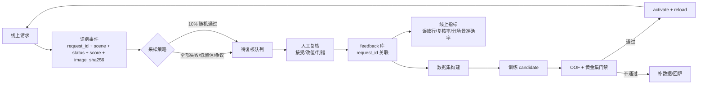

**最小可行方案（不改对外契约）：**

| 数据 | 存储 | 采集方式 | 保留 |
|---|---|---|---|
| 识别事件 | MySQL/PostgreSQL `ai_recognition_event` | 响应后后台任务异步写（失败不阻塞主流程） | 180 天 |
| 图片指纹 | 事件表 `image_sha256` | 计算 SHA-256，不存原图 | 180 天（随事件表） |
| 采样原图 | 对象存储 `spm-sample/` | 仅失败/低置信/争议/10% 随机通过 | 30–90 天 |
| 人工反馈 | `ai_recognition_feedback` | 复核台/上游回传 | 永久 |
| 上游真值 | 数仓 join `biz_id` | 上游审计结果按 `biz_id` 回流 | 按数仓策略 |

**建议增加的可选字段（向后兼容）：**

```http
POST /v1/recognize
  scene       必填
  image       或 image_url
  biz_id      可选：上游工单/照片 ID，用于回填真值与去重
```

- 不传 `biz_id` 时行为完全不变；传了则写入事件表，便于“识别结果 ↔ 最终审计结果”join。
- 禁止把 `biz_id` 当幂等键：同一张图可能因重拍而多次识别；幂等键应是 `request_id` + `image_sha256`。

**采样与标注成本控制：**

| 优先级 | 采样对象 | 比例 | 目的 |
|---|---|---|---|
| P0 | `422` / 5xx / 超时 | 100% | 快速发现系统性问题 |
| P0 | 油液/滤芯 score < 0.75 | 100% | 补当前最缺置信度控制的场景 |
| P1 | 文本类字段校验失败 | 100% | OCR/检测器难例 |
| P1 | 用户重拍/上游判错 | 100% | 真实误放行 |
| P2 | 随机通过 | 5–10%，每日上限 500 | 估计整体准确率，防止“只看见失败” |

**隐私与合规：**

- 车牌、VIN 属于可识别信息；日志默认**不打印原值**，只打印哈希/后四位。
- 采样原图加密存储、最小权限、按天分区；到期自动删除；提供删除接口。
- 训练数据与线上采样数据分开目录、分开权限；禁止把含个人信息的数据带到个人电脑。
- 对外文档与合同中明确：图片仅用于本次识别与质量改进，不用于其他用途。

### 3.7 日志与 bug 定位

**现状：** `obs.py` 每个请求一行访问日志（method/path/status/耗时/rid），能定位“哪次请求慢”，但**不能定位“为什么识别错”**：没有阶段耗时、没有模型版本、没有分数、没有 OCR 候选。

**目标日志模型（JSON，一行一条）：**

```json
{
  "ts": "2026-11-24T10:00:00.123+08:00",
  "level": "INFO",
  "service": "api",
  "env": "prod",
  "request_id": "9f2c1a7b8d3e4f50",
  "caller": "key:spm-prod-01",
  "scene": "license_vin",
  "status": 200,
  "code": "OK",
  "latency_ms": 812,
  "stage_ms": {"download": 0, "preprocess": 12, "detect": 180, "ocr": 590, "rule": 8},
  "model_version": "v5.1.0",
  "image_sha256": "…",
  "image_bytes": 1834221,
  "score": 0.93,
  "reason": null
}
```

**必须补齐的字段：**

| 字段 | 用途 | 注意 |
|---|---|---|
| `request_id` | 全链路关联 | 上游可传，服务回写 `X-Request-Id` |
| `stage_ms` | 定位慢在下载/检测/OCR/规则哪一段 | 每段一个 key，缺段填 0 |
| `model_version` | 区分“模型退化”与“流量变化” | 从 manifest 读，不写死 |
| `image_sha256` | 同一张图复现、去重、缓存 | 不存原图 |
| `score` / `reason` | 解释 422/复核 | 油液/滤芯必须有 |
| `code` | 机器可读错误码 | 与 HTTP 状态解耦 |
| `caller` | 按调用方统计 | Key 只记录前缀/别名，不记录完整密钥 |

**决策快照（可选，默认关闭）：**

`TRACE_DECISIONS=1` 时，把单次请求的中间结果写到 `var/traces/<date>/<request_id>.json`：

- 12 类 top-k + 分数、检测框、OCR 候选与角度、规则命中、最终结论；
- OCR 原文默认脱敏（车牌保留后 3 位，VIN 保留后 4 位），或只存哈希；
- 保留 7 天，按 `request_id` 精确检索；仅排障时开启，避免磁盘和隐私风险。

**链路关联：**

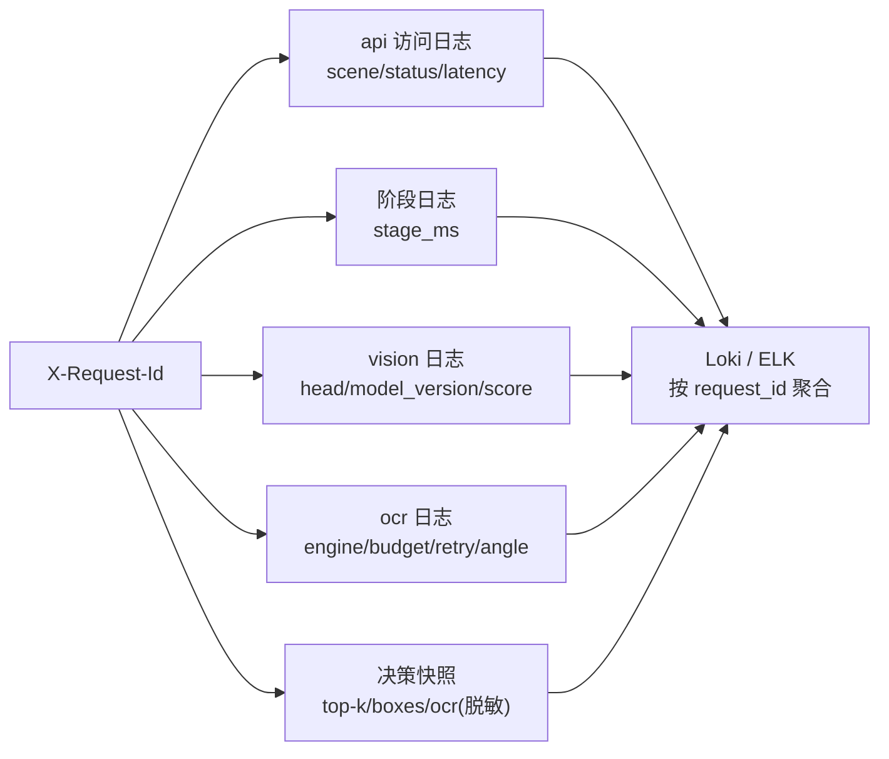

**排障 Runbook：**

| 症状 | 第一动作 | 命令/位置 | 常见原因 |
|---|---|---|---|
| 所有请求 401 | 查 Key 配置与请求头 | `grep API_KEYS .env`；`curl -H 'X-API-Key: …'` | 没配 Key、Key 轮换未同步 |
| 单张 422 | 用 `request_id` 查日志和决策快照 | `var/traces/<date>/<rid>.json` | 场景选错、图片糊、OCR 超时、字段校验失败 |
| 延迟整体升高 | 看 `/metrics` P95、GPU、OCR 队列 | `nvidia-smi`；`docker logs ocr` | OCR 排队、GPU 被训练占用、下游超时 |
| 偶发 5xx | 查异常栈和 `/readyz` | `docker logs api --since 10m` | 下游不可达、模型 reload 失败、OOM |
| 结果和昨天不一样 | 对比 `model_version` 与 `image_sha256` | `/v1/meta`；事件表 | 切了模型、预处理开关变了、图片不同 |
| 大量 429 | 区分 `BUSY` 与 `RATE_LIMITED` | 响应 `code` + `Retry-After` | 并发打满、单调用方超频、Nginx 桶共用 |
| 容器反复重启 | 看 healthcheck 与 OOM | `docker inspect`；`dmesg` | `/healthz` 超时、显存不足、权重缺失 |
| reload 失败 | 校验 manifest 与磁盘 | `models.py verify`；`docker logs vision` | 哈希不符、文件缺失、磁盘满 |
| URL 图片失败 | 查 DNS/代理/白名单 | `curl -v 'URL'`；`image_fetch` 日志 | 对象存储 403、内网 DNS、重定向过多 |
| 同一图结果不稳定 | 查并发与缓存 | 单发对比；OCR 日志 | OCR 并发竞争、角度重试随机、未做缓存 |

**日志治理：**

- 热日志 7 天（Loki/ELK），冷日志 90 天（对象存储）；访问日志与决策快照分开保留。
- 生产 `INFO`，排障临时 `DEBUG`；禁止在日志里打印完整图片二进制、完整车牌/VIN、API Key。
- 每条日志必须能回答：**哪个请求、哪个场景、哪个模型版本、慢在哪、为什么失败**。

### 3.8 监控与告警

**指标（P0 先补齐标签，P1 接 Prometheus）：**

| 指标 | 类型 | 标签 | 用途 |
|---|---|---|---|
| `spm_recognize_requests_total` | counter | `scene,status,code,model_version` | 成功率、错误分布 |
| `spm_recognize_latency_ms` | histogram | `scene` | P50/P95/P99 |
| `spm_stage_latency_ms` | histogram | `stage` | 定位慢在哪一段 |
| `spm_inflight` | gauge | — | 当前并发 |
| `spm_admission_rejected_total` | counter | `reason` | `busy` / `rate_limited` |
| `spm_ocr_requests_total` | counter | `result` | OCR 成功率/超时 |
| `spm_ocr_latency_ms` | histogram | `kind` | 车牌/VIN/里程 |
| `spm_vision_latency_ms` | histogram | `head` | 各头耗时 |
| `spm_model_info` | gauge | `version,manifest_sha` | 版本一致性 |
| `spm_feedback_total` | counter | `verdict` | 误放行/复核率 |

**告警规则（建议）：**

| 级别 | 条件 | 持续 | 动作 |
|---|---|---|---|
| P1 | 5xx / 总请求 > 1% | 5min | 通知值班；查下游与异常栈 |
| P1 | `/readyz` 失败 | 2min | 摘流量；查 vision/ocr |
| P1 | P95 > 5s | 10min | 查 OCR 队列/GPU/429 |
| P1 | 429 比例 > 5% | 5min | 查调用方突增/限流配置 |
| P1 | 模型版本与 `/v1/meta` 不一致 | 1min | 停止放量；核对 reload |
| P1 | GPU 显存 > 90% 或温度异常 | 5min | 降级/扩容；查训练任务 |
| P2 | 复核率较 7 日均值 +20% | 30min | 查数据漂移/模型退化 |
| P2 | 某 scene 422 率较基线 +10pt | 1h | 拉该 scene 样本复核 |
| P2 | 磁盘 > 85% | 30min | 清理日志/旧 run/旧镜像 |
| P3 | 置信度分布均值偏移 > 0.05 | 1d | 数据漂移评估 |

**看板：**

1. **总览**：QPS、成功率、P50/P95、429、在途、模型版本；
2. **分场景**：12 个 scene 的成功率/延迟/复核率；
3. **下游**：vision 各 head 耗时、OCR 成功率/排队、GPU 利用率/显存；
4. **质量**：黄金集准确率趋势、误放行、bad case top N；
5. **发布**：版本切换记录、切换前后 1h 对比。

---

## 4. 接口设计与并发限流

### 4.1 对外契约

```http
POST /v1/recognize
Content-Type: multipart/form-data
```

| 参数 | 类型 | 必填 | 约束 |
|---|---|---|---|
| `scene` | string | 是 | 12 个之一，见 1.2 |
| `image` | file | 二选一 | jpeg/png/webp/tiff，≤15MB，按 magic bytes 判格式 |
| `image_url` | string | 二选一 | http/https，≤15MB，下载预算 3s，最多 3 次重定向 |
| `biz_id` | string | 否（规划） | 上游工单/照片 ID，仅用于事件关联，不参与判定 |

**成功（HTTP 200）：**

```json
{"scene": "license_vin", "message": "识别成功", "data": {"vin": "HLC3J2VEXSA603850"}}
```

**识别不成功（HTTP 422）：**

```json
{"scene": "license_vin", "message": "未识别到 VIN，请对准证件/铭牌重拍", "data": {"vin": null}}
```

**请求/系统错误：**

```json
{"code": "BAD_REQUEST", "message": "scene 必须是以下之一：…", "request_id": "9f2c…", "path": "/v1/recognize"}
```

**运维接口：** `GET /v1/scenes`、`GET /v1/meta`、`GET /healthz`、`GET /readyz`、`GET /metrics`、`GET /docs`。  
`POST /v1/analyze` 仅控制台/内部排查使用，不对外承诺契约，也不在本文的 SLA 范围内。

### 4.2 状态码与错误码

| HTTP | `code` | 含义 | 调用方动作 |
|---|---|---|---|
| 200 | —（成功响应无 `code`） | 本场景识别成功 | 使用 `data` |
| 400 | `BAD_REQUEST` | 参数缺失/互斥/scene 非法/URL 非法 | 修请求，不要重试 |
| 401 | `UNAUTHORIZED` | 缺少/无效 `X-API-Key` | 补 Key，不要重试 |
| 413 | `PAYLOAD_TOO_LARGE` | 单图 >15MB | 压缩/重拍 |
| 422 | `RECOGNIZE_FAILED` | 识别不成功（业务失败） | 按 `message` 提示重拍；**不要原图重试** |
| 422 | `INVALID_PARAMS` | 参数校验失败 | 修请求 |
| 429 | `BUSY` | 全局并发满（1s 内未拿到槽） | 按 `Retry-After` 退避 |
| 429 | `RATE_LIMITED` | 调用方超频 | 按 `Retry-After` 退避 |
| 500 | `INTERNAL_ERROR` | 未捕获异常 | 可重试 1 次；持续则报障 |
| 503 | `SERVICE_UNAVAILABLE` | 下游不可用/未就绪 | 退避；查 `/readyz` |

**P0 契约修正：**

1. 业务 `400/413/422` 也返回 `code`（如 `BAD_REQUEST`/`PAYLOAD_TOO_LARGE`/`RECOGNIZE_FAILED`）与 `request_id`，与中间件错误结构对齐；`scene/message/data` 保持不变，向后兼容。
2. `message` 必须是**可给现场看的中文**，不出现异常类名、堆栈、内部路径；技术细节进日志。
3. 响应头统一带 `X-Request-Id`；429 带 `Retry-After`（秒）。
4. 禁止在 `data` 里放 `boxes`、`scores`、`debug` 等内部字段；需要排障走决策快照。

### 4.3 三层限流

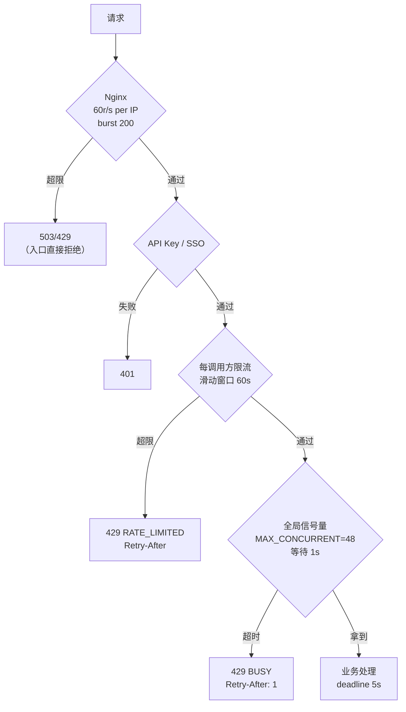

> **目标顺序是“先鉴权、再限流、后准入”**。当前代码里 `admission` 比 API Key 校验更靠外层（A4），P0 调整中间件顺序；SSO 已在准入之前，不受影响。

| 层 | 位置 | 当前值 | 作用 | 已知问题 |
|---|---|---|---|---|
| L1 Nginx | `limit_req_zone` | 60r/s per IP，burst 200 | 挡住单 IP 洪峰 | 经 Nginx 时所有调用方共用容器 IP 桶（A3） |
| L2 每调用方 | `admission.py` | 代码默认 120/min，`.env` 3000/min | 公平性，防止一方打满 | 进程内、单 worker；Key 前缀可能碰撞 |
| L3 全局并发 | `asyncio.Semaphore` | 48，等待 1s | 保护 GPU/OCR，快速失败 | 多副本会翻倍；超时后下游线程仍在跑（A6） |

**P0 修复：**

- Nginx 增加 `proxy_set_header X-Forwarded-For $proxy_add_x_forwarded_for;`，应用只信任来自 Nginx 的 XFF；或改为**按 `X-API-Key` 的别名**限流，不依赖 IP。
- 调整中间件顺序：`request_id → 鉴权 → 限流 → 准入 → 业务`。
- Key 的桶键改用完整 Key 的 HMAC（不可逆）或配置别名，不用 `key[:12]`。

**P1 演进：**

- 限流/准入迁到 Redis（令牌桶 + Lua 原子），API 可水平扩到 2–4 副本；
- 按调用方配置配额（QPS + 日配额），支持临时提额；
- 按场景分池：文本类（OCR 重）与快路径分不同信号量，防止文本类拖垮全部；
- 优先级：交互式请求优先，批量补录走低优先级队列（P3 异步接口）。

### 4.4 容量模型与压测

**Little's Law：** `并发 = 吞吐 × 平均延迟`。

| 平均延迟 | 32 并发对应吞吐 | 说明 |
|---|---|---|
| 0.5s（快路径） | 64 QPS | 油液/滤芯/签章 |
| 1.5s | 21 QPS | 文本类较好情况 |
| 2.0s | 16 QPS | 文本类目标 |
| 3.0s | 10.7 QPS | 接近 P95 上限 |
| 5.0s | 6.4 QPS | 硬截止，已不可接受 |

**OCR 容量（当前配置）：**

- 4 进程 × 每进程 4 线程 = **16 个并发 OCR 引擎**；
- 文本请求平均 1–3 次 OCR（检测裁图 + 角度/车牌重试），单次 0.5–1.5s；
- 按 1.5 次 × 1s 估算，OCR 吞吐约 **10–11 请求/s**；
- 32 并发、平均 2s 时需求约 16 QPS > OCR 容量 → 排队 → P95 超过 5s。这与实测“OCR 路径 16 并发 P95 5.6s”一致。

**结论：** 当前瓶颈是 OCR，不是 GPU 分类头。要达文本路径 32 并发 P95 ≤ 3s，需要至少把 OCR 有效并发提升到 **32–48**，或把单次 OCR 降到 0.5s 以内，二者至少做一项。

| 方案 | 做法 | 吞吐提升 | 成本 | 风险 |
|---|---|---|---|---|
| 加 OCR 进程 | 8 进程 × 4 线程（需 ≥32 核） | ~2× | 中（CPU） | CPU 争抢，需实测 |
| OCR 专用模型 | 车牌/VIN 小模型，减少通用 OCR 变体 | ~1.5–2× | 中 | 需训练/标注 |
| 减少重试 | 只在低置信时角度重试；预算动态化 | ~1.3× | 低 | 少量召回下降 |
| GPU OCR | PaddleOCR/TensorRT 上 GPU | ~3–5× | 高 | 显存与运维复杂度 |
| 结果缓存 | `request_id+image_sha256+scene+model_version` 缓存 10min | 取决于重试率 | 低 | 脏读（换模型要失效） |
| 异步批量 | 非实时补录走队列 | 削峰 | 中 | 不解决实时 SLA |

**压测方案（必须在 L20 生产环境跑，Mac 数字不算）：**

```bash
# 1) 快路径
python scripts/bench_api.py --base http://127.0.0.1:8017 \
  --path /v1/recognize --scene filter_has --image <图> \
  --vus 32 --requests 320 --max-p95-ms 3000

# 2) 文本路径（重点）
python scripts/bench_api.py --base http://127.0.0.1:8017 \
  --path /v1/recognize --scene license_vin --image <图> \
  --vus 16 --requests 160 --max-p95-ms 3000
python scripts/bench_api.py --base http://127.0.0.1:8017 \
  --path /v1/recognize --scene license_vin --image <图> \
  --vus 32 --requests 320 --max-p95-ms 5000

# 3) 混合场景（按业务比例）
# 4) URL 输入（验证下载预算与 SSRF 白名单）
```

**验收标准：**

| 项 | 目标 | 不达标时 |
|---|---|---|
| 32 并发快路径 P95 | ≤ 2.5s | 查 GPU/分类头 |
| 32 并发文本 P95 | ≤ 5s（P0 过渡），P2 收紧到 ≤3s | 调 OCR 进程/预算，或上专用 OCR |
| 32 并发混合 P95 | ≤ 4s（P2 目标 ≤3s） | 先调 OCR 进程/预算，再考虑降级 |
| 429 比例 | ≤ 0.5% | 提高并发上限或扩容 |
| 5xx | 0 | 修异常，不放行 |
| GPU 利用率 | 40–70% | 过低说明瓶颈在 OCR/CPU |
| OCR 排队 | < 1s | 加进程/减重试 |
| 内存 | 无持续增长 | 查图片解码/连接池泄漏 |

### 4.5 超时、重试、幂等与降级

| 机制 | 规则 |
|---|---|
| 硬截止 | API `REQUEST_DEADLINE_S=5`，到点返回 `422`；不允许 30s 长尾 |
| 下载 | URL 下载 ≤3s，且计入总预算；剩余预算传给识别 |
| OCR | `OCR_BUDGET_S=2.5`，车牌重试 `OCR_PLATE_RETRY_S=1.0`；P0 改为按剩余预算动态传入 |
| 下游 | vision 连接/读 5s（检测 10s），OCR 客户端 6s；**OCR 6s 大于外层 5s，是 A5/A6 的根因之一**，P0 收紧到剩余预算且小于 5s |
| 上游重试 | 只重试 `429/5xx`；指数退避 + 抖动，最多 2 次；`422` 不重试（重拍是新请求） |
| 幂等/缓存 | 缓存键 `image_sha256 + scene + model_version`，TTL 10min；`request_id` 用于事件去重；换模型自动失效 |
| 熔断 | OCR/vision 连续失败 > N 次，短时快速失败并 `503`，避免雪崩；P1 实现 |
| 降级 | VLX 不可达 → 跳过签章兜底；OCR 超时 → `422` 提示重拍；vision 不可用 → `/readyz` 503，Nginx 摘流量 |
| 取消 | 超时后入口释放，但线程池任务不能取消；P1 给 OCR 传 deadline，让下游自己早停 |

### 4.6 安全设计

| 风险 | 当前 | 目标 |
|---|---|---|
| 未鉴权 | `API_KEYS` 默认空 | 对外必须配；每调用方独立 Key，90 天轮换 |
| SSRF | `image_url` 无白名单 | 仅允许对象存储域名/IP 段；禁 `169.254.169.254`、localhost、私网（除非显式允许）；解析后校验 IP，防 DNS rebinding |
| 传输 | 内网 HTTP | Nginx 终止 TLS；上游走内网/VPN |
| CORS | `allow_origins=["*"]` | 只允许控制台域名；API 调用不需要 CORS |
| 越权 | 无租户概念 | 单租户内网；多租户时 Key 绑定租户与配额 |
| 数据 | 图片不落盘 | 采样图加密、最小权限、到期删除 |
| 日志 | 可能含字段值 | 默认脱敏；禁止打印完整 Key/车牌/VIN |
| 模型文件 | api 可写 `models/` | vision 只读；api 写权限仅限发布账号，操作审计 |

### 4.7 接口演进原则

- `/v1` 冻结：只做**向后兼容的新增**（新增可选字段、新增响应字段），不删字段、不改语义。
- 破坏性变更走 `/v2`，至少提前 90 天通知，双版本并行 ≥ 1 个季度。
- 文档与代码同仓：`docs/SPM图片ai识别API文档.md` 是唯一对外口径；`/docs` 的 OpenAPI 必须与之一致。
- 每个版本记录：新增/变更/废弃字段、生效日期、迁移方式。

---

## 5. 项目整体打包与部署

### 5.1 制品清单

| 制品 | 内容 | 体积（约） | 产出 |
|---|---|---|---|
| `api` 镜像 | FastAPI + web + scripts；`WITH_TRAIN=1` 带 torch | 392MB / 1.5GB | `deploy/Dockerfile.api` |
| `vision` 镜像 | PyTorch CUDA + ultralytics + 权重挂载 | 数 GB | `deploy/Dockerfile.vision` |
| `ocr` 镜像 | RapidOCR + onnxruntime | 数百 MB | `deploy/Dockerfile.ocr` |
| nginx | 官方镜像 + 配置 | — | `deploy/nginx.conf` |
| 模型包 | `models/<version>/weights/*.pt` + manifest | 每版数十 MB | `scripts/models.py freeze` |
| 升级包 | 代码 + 模型 + 配置；不含 `data/` | ~70–90MB | `deploy/package.sh` |
| 全量包 | 升级包 + `data/` 照片与划分 | ~430MB | `package.sh --with-data` |
| 数据快照 | `data/raw/`（唯一不可再生） | 随业务增长 | 每日备份 |

**打包命令：**

```bash
bash deploy/package.sh                 # 默认升级包
bash deploy/package.sh --since <ref>   # 增量包（只含改动）
bash deploy/package.sh --with-data     # 首次部署全量包
```

包内必须有：`MANIFEST.txt`（版本/commit/文件哈希）、`ENV.OVERRIDES`（本次建议的环境变量）、`deploy/`、`models/`。

### 5.2 部署拓扑

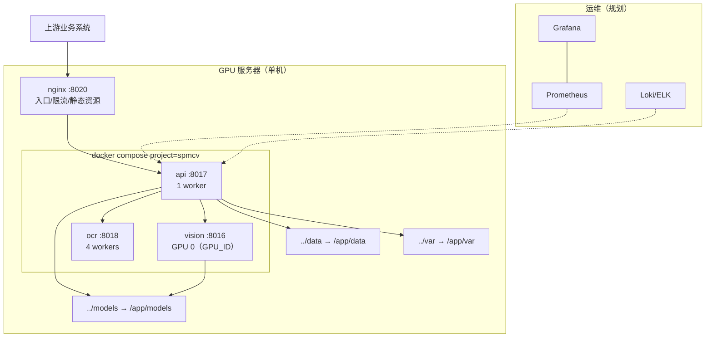

**挂载与权限：**

| 挂载 | 容器 | 权限 | 原因 |
|---|---|---|---|
| `../models` | vision | 只读 | 权重不可被推理进程改 |
| `../models` | api | 读写 | 切版本/写 registry/删除版本 |
| `../data` | api | 读写 | 数据集/上传批次 |
| `../var` | api | 读写 | 日志、训练产物、feedback.sqlite3 |
| `../docs` | api | 只读 | 控制台文档 |

### 5.3 环境变量矩阵

| 变量 | 代码默认 | 生产建议 | 说明 |
|---|---|---|---|
| `API_KEYS` | 空（不校验） | 每调用方一个 Key | 对外必须 |
| `MAX_CONCURRENT` | 48 | 48（压测后调） | 全局准入 |
| `ADMISSION_WAIT_S` | 1 | 1 | 满了快速 429 |
| `RATE_LIMIT_PER_MIN` | 120 | 按调用方配额，如 600–3000 | 每调用方 |
| `REQUEST_DEADLINE_S` | 5 | 5 | 硬截止 |
| `OCR_BUDGET_S` | 2.5 | 2.0–2.5 | 单张 OCR 总预算 |
| `OCR_WORKERS` | 4 | 4–8（按核数） | OCR 进程数 |
| `MODEL_DIR` | 空 | `models/current` | 只设这一个 |
| `VISION_DEVICE` | auto | `cuda` | 生产必须 GPU |
| `GPU_ID` | 0 | 按机器（如 4） | 钉卡，避免抢卡 |
| `ENABLE_FUSION` | 0 | **0** | 7 头同源前禁止开 |
| `PREPROCESS` | auto | auto | 背光条件触发 |
| `VLX_SIGN_FALLBACK` | 1 | 1（可达时） | 签章兜底 |
| `KEV_MODE` | off | off | 非必需 |
| `SSO_MODE` | off | `live`（控制台） | 统一登录 |
| `HOST_PORT` | 8020 | 8020 | 入口 |
| `TZ` | 系统 | `Asia/Shanghai` | 日志时间 |

> **注意：** `docker compose` 不会自动读仓库根目录的 `.env`。必须 `docker compose --env-file .env ...` 或在 shell 中 export；`deploy/update.sh` 已处理，手工操作时容易踩。

### 5.4 发布流程

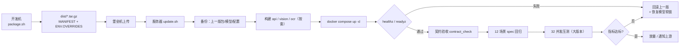

**首次部署：**

```bash
# 1) 端口体检，避免起服务才发现冲突
bash deploy/check_ports.sh

# 2) 配置
cp .env.example .env && vi .env     # API_KEYS / GPU_ID / HOST_PORT

# 3) 模型与数据
python scripts/models.py verify     # 哈希校验
bash deploy/package.sh --with-data  # 或 rsync data/ 一次

# 4) 构建启动（首次 15–25 分钟，vision 必须 Linux + NVIDIA）
docker compose --env-file .env -f deploy/docker-compose.yml up -d --build

# 5) 验收
curl -s localhost:8020/healthz
curl -s localhost:8020/readyz | jq .
bash deploy/smoke_compose.sh
```

**日常升级：**

```bash
bash deploy/package.sh                    # 开发机
# 上传到 /root/ 后：
cd /opt/spmcv && bash deploy/update.sh /root/spmcv-release-*.tar.gz
# 改了 vision/ocr 依赖：加 --all；只改配置：加 --no-build
```

`update.sh` 会：校验包完整性 → 记录当前版本到 `var/backup/` → 解包 → 合并 `ENV.OVERRIDES` → `compose config` → 构建 → 重启 → 等 `/healthz` → 跑契约验收 → 打印版本与容器状态；任一步失败非 0 退出，旧容器不受影响。

### 5.5 回滚

| 对象 | 操作 | 时间 | 验证 |
|---|---|---|---|
| 应用 | 用上一版包重新 `update.sh`（`--no-build` 更快） | 1–5min | `/healthz` + 契约 |
| 模型 | `models.py activate <prev> --rollback` + `/v1/reload` | ≤1min | `/v1/meta` + `/readyz` |
| 配置 | `var/backup/last_update_*.txt` 恢复 `.env` + 重启 | 1min | `/v1/meta.limits` |
| 数据 | 从备份恢复（极少） | 小时级 | 抽样校验 |

**回滚演练：** 每季度一次，随机选一个 previous 版本，计时从决定到恢复服务；目标 < 10 分钟。

### 5.6 发布策略与零停机

**现状：** 单 API worker，`docker compose up -d` 重建 api 时有几秒不可用；vision reload 会短暂阻塞推理。

**演进：**

| 阶段 | 策略 | 代价 |
|---|---|---|
| 现在（试点） | 低峰期发布，上游容忍短暂 5xx | 简单，有分钟级抖动 |
| P1 | API 双副本 + Redis 限流；Nginx `max_fails` 被动摘流 + 滚动更新 | 需外置状态 |
| P2 | 模型 canary：按 `request_id` 哈希 5% 流量走新版本，对比错误率/延迟后全量 | 需双模型常驻或快速 reload |
| P3 | 蓝绿 vision（双卡/双机），Nginx 切上游 | 成本高，适用于全量生产 |

**canary 判定（P1）：**

- 5% 流量，至少 500 次请求；
- 新版本 5xx 不高于旧版本 +0.5pt；
- P95 不高于旧版本 +20%；
- 黄金集离线指标不低于旧版本；
- 任一不满足自动回滚并告警。

### 5.7 容量、磁盘与备份

| 项 | 建议 | 说明 |
|---|---|---|
| 磁盘 | ≥100GB（最低 30GB） | 镜像 ~6GB + 数据 + 训练产物 + 日志 |
| 内存 | ≥32GB | OCR 多进程 + 图片解码 |
| GPU | 1×L20（当前） | 训练与推理错峰；扩容按卡 |
| 日志 | 热 7 天 / 冷 90 天 | 防止磁盘被日志打满 |
| 备份 | `data/raw` 每日、`models` 每次发布、`feedback.sqlite3` 每日 | 异地/对象存储 |
| 监控 | Prometheus + Grafana + Loki（P1） | 先接 `/metrics` 和 JSON 日志 |

**备份恢复演练：** 每季度从备份恢复一次 `feedback.sqlite3` 与一个模型版本，验证可用。

---

## 6. 数仓关联（规划）

> 本章是规划，不代表当前已接入数仓。技术栈按公司数据平台实际情况调整（Doris / StarRocks / Hive + Spark 均可）。

### 6.1 现状与目标

**现状：**

- 识别结果只存在于 API 响应和进程日志；没有落到业务库。
- 标注数据在 `var/feedback.sqlite3`，是单机文件，无法直接进数仓。
- 没有“识别结果 ↔ 工单最终审计结果”的关联键，因此**真实误放行率算不出来**。

**目标：**

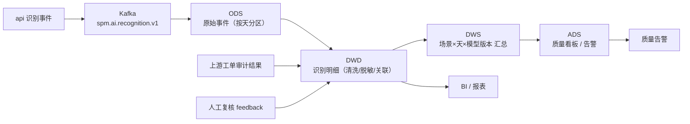

### 6.2 数据分层

| 层 | 表 | 粒度 | 内容 | 保留 |
|---|---|---|---|---|
| ODS | `ods_spm_recognition_event_di` | 一次请求 | 原始 JSON，含 `request_id/biz_id/scene/http_status/latency/model_version/image_sha256` | 180 天 |
| DWD | `dwd_ai_recognition_detail_di` | 一次请求 | 清洗、类型转换、脱敏、关联工单/复核 | 365 天 |
| DWS | `dws_ai_scene_1d` | scene × 天 × 模型版本 | 请求数、成功数、P95、复核数、误放行数 | 730 天 |
| DWS | `dws_ai_caller_1d` | 调用方 × 天 | 调用量、429、错误率、P95 | 730 天 |
| ADS | `ads_ai_quality_1d` | 天 | 质量总分、Top bad case、版本对比 | 730 天 |
| ADS | `ads_ai_model_release_1d` | 版本 × 天 | 发布后质量/延迟对比 | 永久 |

### 6.3 关联键与血缘

| 键 | 来源 | 用途 |
|---|---|---|
| `request_id` | API 生成/上游透传 | 请求级关联，日志/事件/反馈 |
| `biz_id` | 上游传入（规划） | 关联工单、照片、最终审计结果 |
| `image_sha256` | API 计算 | 同一张图去重、复现、缓存 |
| `model_version` | manifest | 版本对比、回滚定位 |

**血缘：** `api 请求 → 事件表 → DWD（join 工单/复核）→ DWS → ADS → 看板/告警`。任何指标都能下钻到 `request_id`，再回到日志与决策快照。

### 6.4 指标口径

| 指标 | 公式 | 说明 |
|---|---|---|
| 识别成功率 | `200 / (200 + 422)` | 不含 400/401/413/429/5xx；按 scene 分 |
| 请求错误率 | `(4xx + 5xx) / 总请求` | 区分客户端错误与服务端错误 |
| 自动通过率 | 无需人工复核即通过的工单 / 总工单 | **上游口径**，需 join 工单结果 |
| 复核率 | 触发复核的图片 / 识别图片 | 上游或本服务标记 |
| 误放行率 | 返回 200 但字段被人工判错 / 200 总数 | 需黄金集或复核反馈 |
| 重拍率 | 422 / (200+422) | 按 scene 看拍摄引导效果 |
| P95 延迟 | 请求耗时 95 分位 | 分 scene、分快/慢路径 |
| 429 率 | 429 / 总请求 | 分 `BUSY` / `RATE_LIMITED` |
| 单图成本 | (GPU + CPU + 存储 + 带宽) / 识别量 | 月度 |

### 6.5 数据质量检查

| 检查 | 规则 | 处理 |
|---|---|---|
| 主键唯一 | `request_id` 不重复 | 重复则告警，保留首条 |
| 枚举合法 | `scene` ∈ 12，`http_status` ∈ {200,422,400,401,413,429,5xx} | 非法进脏数据表 |
| 版本非空 | `model_version` 不为空/`unregistered` | 告警，补 manifest |
| 延迟合理 | `0 < latency_ms < 60000` | 异常值标记，不参与 P95 |
| 反馈有主 | `feedback.request_id` 能在事件表找到 | 找不到进孤儿表，人工处理 |
| 时钟 | 事件时间与入库时间差 < 5min | 超差告警 |

### 6.6 隐私与保留

- ODS/DWD 不存原图，只存 `image_sha256` 与必要元数据；采样原图单独存对象存储。
- 车牌/VIN 在 DWD 层脱敏（保留后 3–4 位），需要原值的场景走审批 + 审计。
- 按天分区，到期自动删除；支持按 `biz_id`/`request_id` 删除。
- 数仓访问按角色授权：算法看脱敏明细，业务看汇总，运维看延迟/错误。

---

## 7. 数据库 DDL

### 7.1 现有 SQLite（单机标注台，已实现）

```sql
-- 标注审计：append-only，任何改标都可追溯
CREATE TABLE label_events (
  id INTEGER PRIMARY KEY AUTOINCREMENT,
  image_path TEXT NOT NULL,
  action TEXT NOT NULL,
  payload TEXT NOT NULL,
  reviewer TEXT NOT NULL DEFAULT '',
  created_at TEXT NOT NULL
);

-- 人工结论：优先于目录标签进入训练
CREATE TABLE annotations (
  image_path TEXT PRIMARY KEY,
  source_dataset TEXT NOT NULL DEFAULT '',
  source_label TEXT NOT NULL DEFAULT '',
  model_prediction TEXT NOT NULL DEFAULT '',
  model_confidence REAL,
  final_label TEXT NOT NULL,
  status TEXT NOT NULL,
  note TEXT NOT NULL DEFAULT '',
  evidence_status TEXT NOT NULL DEFAULT 'unclear',
  action_evidence TEXT NOT NULL DEFAULT 'unclear',
  reviewer TEXT NOT NULL DEFAULT '',
  model_version TEXT NOT NULL DEFAULT '',
  taxonomy_version TEXT NOT NULL DEFAULT 'v1',
  updated_at TEXT NOT NULL
);

-- 改标计划：先预览，显式 --apply 才搬数据
CREATE TABLE relabel_plan (
  src TEXT PRIMARY KEY,
  to_label TEXT NOT NULL,
  from_label TEXT NOT NULL DEFAULT '',
  note TEXT NOT NULL DEFAULT '',
  reviewer TEXT NOT NULL DEFAULT '',
  added_at TEXT NOT NULL
);

-- 自动标注与难例
CREATE TABLE auto_labels (
  image_path TEXT PRIMARY KEY,
  batch TEXT NOT NULL DEFAULT '',
  prediction TEXT NOT NULL DEFAULT '',
  confidence REAL,
  model_version TEXT NOT NULL DEFAULT '',
  created_at TEXT NOT NULL
);
CREATE TABLE hard_cases (
  path TEXT PRIMARY KEY,
  want TEXT NOT NULL DEFAULT '',
  got TEXT NOT NULL DEFAULT '',
  note TEXT NOT NULL DEFAULT '',
  reviewer TEXT NOT NULL DEFAULT '',
  added_at TEXT NOT NULL
);
```

> SQLite 适合单机标注台；**不要**让多副本 API 直接写它。线上事件表用 MySQL/PostgreSQL。

### 7.2 识别事件表（规划，MySQL 8）

```sql
CREATE TABLE ai_recognition_event (
  id            BIGINT UNSIGNED NOT NULL AUTO_INCREMENT,
  request_id    VARCHAR(64)  NOT NULL COMMENT '请求唯一 ID，上游可透传',
  biz_id        VARCHAR(64)  DEFAULT NULL COMMENT '上游工单/照片 ID，用于回填真值',
  caller        VARCHAR(64)  NOT NULL DEFAULT '' COMMENT '调用方别名，不存完整 Key',
  scene         VARCHAR(32)  NOT NULL COMMENT '12 场景之一',
  http_status   SMALLINT     NOT NULL COMMENT '200/422/400/401/413/429/5xx',
  code          VARCHAR(32)  NOT NULL COMMENT 'OK/RECOGNIZE_FAILED/BUSY/...',
  reason        VARCHAR(64)  DEFAULT NULL COMMENT '失败原因，如 vin_not_found',
  latency_ms    INT          NOT NULL,
  stage_json    JSON         DEFAULT NULL COMMENT 'download/preprocess/detect/ocr/rule',
  model_version VARCHAR(32)  NOT NULL DEFAULT '',
  image_sha256  CHAR(64)     NOT NULL,
  image_bytes   INT          NOT NULL DEFAULT 0,
  score         DECIMAL(6,5) DEFAULT NULL,
  need_review   TINYINT(1)   NOT NULL DEFAULT 0,
  created_at    DATETIME(3)  NOT NULL DEFAULT CURRENT_TIMESTAMP(3),
  PRIMARY KEY (id),
  UNIQUE KEY uk_request_id (request_id),
  KEY idx_scene_created (scene, created_at),
  KEY idx_status_created (http_status, created_at),
  KEY idx_biz (biz_id),
  KEY idx_image (image_sha256)
) ENGINE=InnoDB DEFAULT CHARSET=utf8mb4
  COMMENT='单图识别事件；异步写，失败不阻塞主流程';
```

### 7.3 人工反馈表（规划）

```sql
CREATE TABLE ai_recognition_feedback (
  id             BIGINT UNSIGNED NOT NULL AUTO_INCREMENT,
  request_id     VARCHAR(64) NOT NULL,
  verdict        ENUM('accept','reject','retake','unknown') NOT NULL,
  corrected_json JSON DEFAULT NULL COMMENT '人工改后的字段，如 {"vin":"..."}',
  reviewer       VARCHAR(64) NOT NULL DEFAULT '',
  source         VARCHAR(32) NOT NULL DEFAULT 'manual'
                 COMMENT 'manual/upstream_audit/retake',
  created_at     DATETIME(3) NOT NULL DEFAULT CURRENT_TIMESTAMP(3),
  PRIMARY KEY (id),
  KEY idx_request (request_id),
  KEY idx_verdict_created (verdict, created_at)
) ENGINE=InnoDB DEFAULT CHARSET=utf8mb4
  COMMENT='人工复核/上游审计结果；与事件表按 request_id 关联';
```

### 7.4 模型发布表（规划，与 registry.json 双写）

```sql
CREATE TABLE ai_model_release (
  version          VARCHAR(32) PRIMARY KEY,
  status           ENUM('candidate','active','previous','retired','archived') NOT NULL,
  manifest_sha256  CHAR(64) NOT NULL,
  evidence_path    VARCHAR(255) DEFAULT NULL,
  evidence_sha256  CHAR(64) DEFAULT NULL,
  metrics_json     JSON DEFAULT NULL,
  activated_at     DATETIME(3) DEFAULT NULL,
  created_at       DATETIME(3) NOT NULL DEFAULT CURRENT_TIMESTAMP(3)
) ENGINE=InnoDB DEFAULT CHARSET=utf8mb4;
```

### 7.5 数仓 ADS 示例（Doris/StarRocks 风格）

```sql
CREATE TABLE ads_ai_quality_1d (
  dt              DATE        NOT NULL COMMENT '统计日期',
  scene           VARCHAR(32) NOT NULL,
  model_version   VARCHAR(32) NOT NULL,
  requests        BIGINT      NOT NULL DEFAULT 0,
  success         BIGINT      NOT NULL DEFAULT 0,
  fail            BIGINT      NOT NULL DEFAULT 0,
  review          BIGINT      NOT NULL DEFAULT 0,
  false_pass      BIGINT      NOT NULL DEFAULT 0,
  p95_latency_ms  INT         NOT NULL DEFAULT 0,
  updated_at      DATETIME    NOT NULL DEFAULT CURRENT_TIMESTAMP
) ENGINE=OLAP
DUPLICATE KEY(dt, scene, model_version)
DISTRIBUTED BY HASH(scene) BUCKETS 8
PROPERTIES ("replication_num" = "3");
```

> 生产建表按数据平台规范补分区、生命周期、压缩与权限；本文只给字段口径。

---

## 8. 代码规范与注释

### 8.1 基本规范

| 项 | 规范 |
|---|---|
| Python | 3.11；`ruff` line-length 100；类型标注；`from __future__ import annotations` |
| 异步 | 事件循环里不做阻塞 IO/CPU；推理用 `asyncio.to_thread`；禁止在 async 函数里 `time.sleep` |
| 配置 | 统一 `app/config.py` 的 `Settings`；新增环境变量必须补 `.env.example` 和部署文档 |
| 错误 | 业务失败用 `HTTPException(status, {"code","message"})`；禁止裸 `except` 吞异常，至少 `log.exception` |
| 日志 | 结构化字段；必带 `request_id`；禁止打印完整 Key、车牌、VIN、图片二进制 |
| 测试 | 一个行为一个测试；新增接口必须有契约测试；修 bug 先写复现测试 |
| 前端 | 无构建、原生 JS；`/ui/` 不缓存；请求统一走 `fetch` 包装，处理 `X-Request-Id` |
| 模型 | 版本目录不可变；训练脚本固定 seed；manifest 记录数据/折分/commit |

### 8.2 注释规范

**原则：注释解释“为什么”，代码表达“做什么”。**

```python
# ✅ 好：解释踩过的坑和取舍
# 必须用 PNG：实测把 1080×1440 的 JPEG 重编码后，车牌小字被压缩噪声糊掉，
# 识别直接失败（jpg 变体 plate=None，png 变体正确）。
def _downscale(data: bytes) -> bytes:
    ...

# ❌ 差：复述代码
# 如果长度大于 400KB 就调用 _downscale
if len(data) > 400 * 1024:
    data = await asyncio.to_thread(_downscale, data)
```

**要求：**

1. 文件头 docstring 写清职责、输入输出、关键取舍、已知坑。
2. 魔法数字必须有注释（阈值、超时、重试次数、并发数）。
3. 降级/兜底分支必须写“为什么可以这样降级”。
4. 复杂 SQL/正则/字段解析必须给示例。
5. 注释与代码一起改；过期注释比没有注释更糟。
6. 不在注释里写“TODO 某人某天”，用 issue 链接。

### 8.3 分支与提交

- 主干开发 + 短分支；分支生命周期 ≤ 1 周。
- 提交信息：`type(scope): subject`，如 `fix(api): 统一 422 错误结构`；type ∈ feat/fix/docs/test/chore/refactor/perf。
- PR ≤ 400 行；超过拆分为“行为不变的重构”+“行为变更”。
- 合并前必须：`ruff` + `pytest` + 契约检查通过；涉及模型/部署的附验证记录。

### 8.4 CI 门禁（建议）

```bash
ruff check app scripts tests
pytest tests -q
python scripts/check_syntax.py
# 起服务后：
python scripts/contract_check.py --base http://127.0.0.1:8017 --scene arrival_plate --photo <图>
```

---

## 9. 任务拆分

> 人日估算含开发、自测、联调，不含业务标注人力。P0/P1/P2 可部分并行；按 1 后端 + 1 算法 + 0.5 运维估算。

### 9.1 P0 上线加固（约 30 人日，2 周）

| ID | 任务 | 交付物 | 人日 | 依赖 | 负责 |
|---|---|---|---|---|---|
| P0-1 | 统一 422 结构：`code`/`request_id`，保留 `scene/data` | 代码 + 契约测试 + API 文档 | 2 | — | 后端 |
| P0-2 | 油液/滤芯置信度阈值 + 文本复核规则接入（VIN 校验位/车牌末位） | 阈值配置 + 规则映射 + 校准报告 | 3 | 黄金集初版（100 张） | 算法/后端 |
| P0-3 | 中间件顺序：鉴权→限流→准入；XFF/Key 桶修复 | 代码 + 单测 | 2 | — | 后端 |
| P0-4 | 动态 deadline：剩余预算传 OCR；下载/OCR 联动 | 代码 + 超时测试 | 2 | — | 后端 |
| P0-5 | `image_url` SSRF 白名单（域名/IP/重定向） | 代码 + 安全测试 | 1 | — | 后端 |
| P0-6 | 结构化日志 + `stage_ms` + 下游 request_id 透传 | 日志规范 + 样例 | 4 | — | 后端 |
| P0-7 | metrics 标签 + Grafana 看板 + 告警规则 | 看板 JSON + 告警配置 | 4 | P0-6 | 运维/后端 |
| P0-8 | L20 压测：1/8/16/32/64 并发；OCR 调参 | 压测报告 + 调参结论 | 3 | P0-4 | 运维/算法 |
| P0-9 | 黄金集 v1：300 张，双标+仲裁 | 数据集 + 评测脚本 | 8 | 业务 | 算法/业务 |
| P0-10 | 文档对齐：部署/热加载/错误码 | 更新 3 份文档 | 1 | — | 后端 |

**P0 退出标准：** 12 场景回归通过；32 并发快路径 P95 ≤2.5s、文本路径 P95 ≤5s、429 ≤0.5%；错误结构统一；日志可按 `request_id` 还原一次请求；无 P0 级安全漏洞。

### 9.2 P1 数据闭环与发布工程（约 49 人日，6 周）

| ID | 任务 | 交付物 | 人日 | 依赖 |
|---|---|---|---|---|
| P1-1 | 识别事件表 + 异步写入 + 采样 | 表 + writer + 压测 | 5 | P0-6 |
| P1-2 | 复核 API/页面：接受/改值/判错 | 页面 + 接口 + 审计 | 5 | P1-1 |
| P1-3 | `biz_id` 可选字段 + 上游审计回流 | 契约增量 + join 任务 | 4 | 上游配合 |
| P1-4 | 难例队列 + 主动学习采样 | 队列 + 周报 | 6 | P1-1 |
| P1-5 | 7 头同源重训 + 融合 A/B | 新 bundle + 报告 + 开关 | 10 | P0-9 |
| P1-6 | canary + 自动回滚 | 分流 + 指标对比 + 回滚脚本 | 6 | P1-1 |
| P1-7 | API 双副本 + Redis 限流/准入 | 部署 + 压测 | 8 | P0-3 |
| P1-8 | 结果缓存/幂等 | 缓存 + 失效策略 | 2 | P1-1 |
| P1-9 | 日志中心化（Loki/ELK） | 采集 + 检索 | 3 | P0-6 |

**P1 退出标准：** 线上事件 100% 落库；失败/低置信 100% 可抽样复核；误放行率首次有基线；模型切换可灰度、可在 5 分钟内回滚；API 可双副本。

### 9.3 P2 精度与性能（约 59 人日，10 周）

| ID | 任务 | 交付物 | 人日 |
|---|---|---|---|
| P2-1 | 分类法解耦：部件 + 属性，多任务训练 | v6 模型 + 映射层 | 15 |
| P2-2 | 检测器扩样：200 → 1500+ 框 | det_v3 + 评测 | 12 |
| P2-3 | OCR 专项：车牌/VIN/里程 + TensorRT | 新 OCR 配置 + 对比 | 12 |
| P2-4 | 多卡/推理队列 | 部署方案 + 压测 | 8 |
| P2-5 | 数仓 pipeline + 质量看板 | ODS/DWD/DWS/ADS | 8 |
| P2-6 | 成本与容量模型 | 月度成本报告 | 4 |

**P2 退出标准：** 文本类 32 并发 P95 ≤ 3s；关键场景准确率 ≥ 目标；单图成本下降 ≥ 20%；数仓看板可用。

### 9.4 P3 规模化（约 36 人日，H2）

| ID | 任务 | 交付物 | 人日 |
|---|---|---|---|
| P3-1 | 多租户/配额/计费 | Key 绑定租户 + 配额 | 10 |
| P3-2 | 异步批量接口 | 提交/查询/回调 | 8 |
| P3-3 | 蓝绿/多机部署 | 双机 + 切流 | 10 |
| P3-4 | 模型治理：漂移检测/影子评估 | 周报 + 自动告警 | 8 |

---

## 10. 测试用例

### 10.1 现有测试资产

| 资产 | 命令 | 覆盖 |
|---|---|---|
| 单元测试 138 个（125 个测试函数） | `make test` | 契约、规则、字段、OCR 重建、模型注册、SSO、预处理 |
| 契约检查 | `make contract-check PHOTO=<图>` | 对外状态码/错误结构/`X-Request-Id` |
| 12 场景回归 | `make eval-recognize` | 规格样例逐场景 |
| 浏览器回归 | `make ui-test` | 控制台关键路径 |
| 压测 | `make bench ARGS='--vus 32 …'` | 延迟/429/错误率 |

### 10.2 新增测试用例（P0/P1）

| ID | 类型 | 场景/步骤 | 期望 |
|---|---|---|---|
| TC-01 | 契约 | 12 个 scene 各打一张合法图 | 200，`data` 字段齐全，`X-Request-Id` 存在 |
| TC-02 | 契约 | 业务失败（模糊图） | 422，含 `code=RECOGNIZE_FAILED`、`request_id`、`scene`、`data=null` |
| TC-03 | 契约 | 缺 `scene` / scene 非法 | 400 或 422 `INVALID_PARAMS`，结构统一 |
| TC-04 | 参数 | 同时传 `image` 和 `image_url` | 400，提示二选一 |
| TC-05 | 参数 | 空文件 / 非图片 magic | 400 |
| TC-06 | 限制 | 16MB 图 | 413 |
| TC-07 | 限制 | 扩展名 `.png` 实为 JPEG | 200/422 正常处理（按 magic） |
| TC-08 | 安全 | 50MP 解压炸弹 | 400/413，不 OOM |
| TC-09 | 安全 | `image_url=http://169.254.169.254/...` | 400（SSRF 拦截） |
| TC-10 | 安全 | URL 重定向 4 次 | 400 |
| TC-11 | 限流 | 并发打满（>48） | 429 `BUSY` + `Retry-After` |
| TC-12 | 限流 | 单 Key 超每分钟配额 | 429 `RATE_LIMITED`；另一 Key 不受影响 |
| TC-13 | 鉴权 | 无 `X-API-Key`（已配置 Key） | 401，且不占并发槽（P0-3 后） |
| TC-14 | 模型 | 油液图 score 低于阈值 | 422（P0-2 后），不得 200 |
| TC-25 | 规则 | VIN 校验位不通过 | 422（P0-2 后），不得静默 200 |
| TC-26 | 规则 | 车牌末位非 D/F | 422 或明确复核标记（P0-2 后） |
| TC-15 | 超时 | OCR 人为延迟 > deadline | 422，`stage_ms.ocr` 有值，入口槽释放 |
| TC-16 | 模型 | `/v1/reload` 加载损坏 manifest | 500，旧权重仍可服务 |
| TC-17 | 模型 | 回滚到 previous | `/v1/meta` 与 `/readyz` 版本一致 |
| TC-18 | 并发 | 32 并发混合场景 320 请求 | 按阶段目标：P0 混合 ≤4s、P2 ≤3s；429 ≤0.5%，5xx=0 |
| TC-19 | 降级 | 停 OCR | `/readyz` 503；API 不崩溃 |
| TC-20 | 数据 | 同一 `request_id` 重复写事件 | 幂等，不重复计数 |
| TC-21 | 数据 | 事件库写入失败 | 主流程仍返回 200/422（异步降级） |
| TC-22 | 隐私 | 日志检查 | 不含完整车牌/VIN/Key |
| TC-23 | 缓存 | 切模型后同图同 scene | 缓存失效，走新模型 |
| TC-24 | 兼容 | 老上游不传 `biz_id` | 行为不变 |

### 10.3 验收口径

- 功能：TC-01–TC-17、TC-25、TC-26 全绿；TC-18 在 L20 上达标。
- 安全：TC-09、TC-13、TC-22 必过。
- 数据：TC-20、TC-21 必过，且事件表可下钻到日志。
- 回归：每次发布跑 12 场景 + 契约 + 黄金集；指标下降超过阈值则阻断发布。

---

## 11. CR 与 Showcase

### 11.1 Code Review 清单

| # | 检查项 | 阻断条件 |
|---|---|---|
| 1 | 契约是否变化？文档/测试是否同步 | 改了响应字段但没改 API 文档 |
| 2 | 错误码/错误结构是否统一 | 新分支返回裸字符串/无 `request_id` |
| 3 | 输入校验：大小/格式/URL/权限 | 新增入口无大小或来源校验 |
| 4 | 并发/超时/降级 | 同步阻塞调用、无 deadline、无降级 |
| 5 | 日志与指标 | 关键分支无日志、日志含 PII |
| 6 | 模型版本/manifest | 改了权重但没升版本/没 manifest |
| 7 | 数据迁移/兼容 | 破坏性 DDL、无回滚 |
| 8 | 性能预算 | 新增 >100ms 的同步步骤且无说明 |
| 9 | 测试 | 无新增/更新测试 |
| 10 | 文档 | 部署/环境变量/接口未更新 |
| 11 | 安全 | 新增加密/鉴权/白名单缺失 |
| 12 | 可回滚 | 无法一键回滚的变更 |

### 11.2 PR 模板

```markdown
## 变更
- 一句话说明

## 契约影响
- [ ] 无
- [ ] 新增可选字段（兼容）
- [ ] 破坏性变更（需 /v2）

## 验证
- [ ] pytest
- [ ] contract_check
- [ ] 12 场景回归
- [ ] 压测（如涉及性能）

## 模型
- [ ] 不涉及
- [ ] 版本：____，manifest sha256：____

## 回滚
- 命令/步骤：
```

### 11.3 Showcase 脚本（10 分钟）

| 时间 | 内容 | 证据 |
|---|---|---|
| 0:00–1:00 | 业务链路：工单拍照 → 单图识别 → 上游规则 | 架构图 |
| 1:00–3:00 | 12 场景现场演示：成功、失败、重拍提示 | 控制台/`curl` |
| 3:00–5:00 | 32 并发压测实时曲线 | `bench_api` + Grafana |
| 5:00–7:00 | 模型切换/回滚：版本、manifest、`/v1/meta` | 命令行 + 看板 |
| 7:00–9:00 | 数据闭环：事件 → 复核 → 数据集 → 候选 | 页面/表 |
| 9:00–10:00 | 上线清单与风险 | 本文第 12 章 |

**演示兜底：** 预录 2 分钟视频 + 固定图片集；现场网络/GPU 异常时切换录像，不现场 debug。

---

## 12. 上线 LIST

> 逐项打勾；每项必须有证据（命令输出/报告/截图），不能只写“已完成”。

### 12.1 代码与契约

- [ ] 138 个测试全绿（`make test`）
- [ ] 契约检查通过（`make contract-check`）
- [ ] 12 场景规格回归通过（`make eval-recognize`）
- [ ] 422/400/429/5xx 结构与文档一致
- [ ] 错误 `message` 可给现场看，无堆栈/内部路径
- [ ] `X-Request-Id` 全链路透传

### 12.2 模型与数据

- [ ] `models.py verify` 通过（7/7 文件哈希）
- [ ] 版本号/manifest/registry 一致
- [ ] 候选有 OOF + 黄金集 + 业务风险 + 完整性四项证据
- [ ] `ENABLE_FUSION=0`（7 头未同源前）
- [ ] 训练数据/折分/manifest SHA 已记录
- [ ] 黄金集 v1 已锁定并跑过基线
- [ ] 回滚版本（previous）保留且校验通过

### 12.3 性能与容量

- [ ] L20 上 32 并发快路径 P95 ≤2.5s
- [ ] L20 上 32 并发文本路径 P95 ≤5s，429 ≤0.5%
- [ ] 32 并发混合场景 P95 ≤4s（P2 收紧到 ≤3s）
- [ ] 1/8/16/32/64 并发梯度压测完成
- [ ] OCR 进程数/预算按实测调优
- [ ] GPU 显存/利用率有监控
- [ ] 磁盘 ≥100GB，日志轮转生效

### 12.4 安全与合规

- [ ] `API_KEYS` 已配置，按调用方分发
- [ ] SSO `live`（控制台）验证通过
- [ ] `image_url` 白名单/私网拦截生效
- [ ] CORS 限制到控制台域名
- [ ] 日志无完整车牌/VIN/Key
- [ ] 采样图加密/保留期/删除流程明确
- [ ] 对外文档/合同中的数据使用条款确认

### 12.5 可观测与运维

- [ ] `/healthz`、`/readyz`、`/metrics` 可访问
- [ ] 日志可按 `request_id` 检索
- [ ] 看板：QPS/成功率/P95/429/模型版本
- [ ] 告警：5xx、P95、429、readyz、GPU、磁盘
- [ ] 值班表与升级路径明确
- [ ] `update.sh` 升级演练通过
- [ ] 回滚演练（应用 + 模型）≤10 分钟
- [ ] 备份：`data/raw`、`models`、`feedback.sqlite3`

### 12.6 业务验收

- [ ] 上游联调通过（12 场景各 10 张）
- [ ] 失败提示文案业务确认
- [ ] 误放行/复核阈值业务签字
- [ ] 灰度范围/回滚窗口确认
- [ ] 上线通知与联系人确认

---

## 13. 后续迭代规划

### 13.1 规划原则

1. **先可用，再准确，再规模化**：P0 不追求精度提升，先把“能定位、能回滚、不误放行”做扎实。
2. **每个阶段都有可验证的退出标准**：没有证据不算完成。
3. **模型迭代由数据驱动**：没有黄金集和线上反馈，不做大改；先补评估，再动结构。
4. **契约稳定**：内部可以换分类法/模型，对外 `/v1` 不变；破坏性变更走 `/v2`。
5. **单机先跑通，再谈 HA**：当前单 GPU/单机是现实约束，先把它用稳，再扩。

### 13.2 路线图

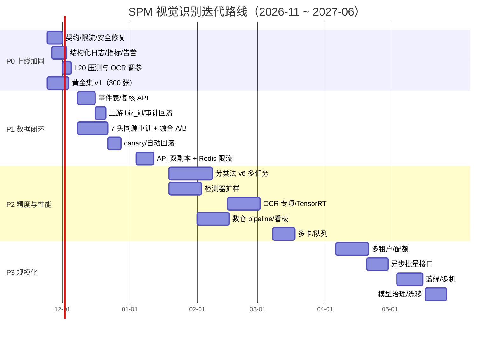

### 13.3 阶段目标与退出标准

#### P0 · 上线加固（2 周，2026-11-24 ~ 12-05）

**目标：从“能演示”到“敢试点”。**

| 交付 | 验收 |
|---|---|
| A1–A5、A7、A8 修复 | 每条有单测/回归；错误结构统一；SSRF 拦截用例通过 |
| 黄金集 v1 | 300 张，双标+仲裁，基线报告落库 |
| 压测报告 | L20 上 1/8/16/32/64 并发；快路径 ≤2.5s、文本 ≤5s、混合 ≤4s |
| 可观测 | 看板 + 5 条 P1 告警 + 日志按 `request_id` 可查 |
| 文档 | API/部署/热加载/回滚四处与代码一致 |

**退出：** 上线 LIST 12.1–12.4 全绿；业务方确认试点范围和复核流程。

#### P1 · 数据闭环与发布工程（6 周，2026-12-08 ~ 2027-01-16）

**目标：从“敢试点”到“可运营”。**

| 交付 | 验收 |
|---|---|
| 识别事件 100% 落库 | 可按下钻到 `request_id`；写入失败不影响主流程 |
| 复核闭环 | 失败/低置信 100% 可抽样；误放行率首次有基线 |
| 7 头同源 bundle | OOF + 黄金集不低于当前；融合 A/B 有结论 |
| canary + 自动回滚 | 5% 流量；异常 5min 内自动回滚 |
| API 双副本 | Redis 限流；并发上限仍为全局 48 |
| 日志中心化 | Loki/ELK 可按 scene/版本/错误码聚合 |

**退出：** 误放行率 ≤1.5%（或业务确认阈值）；回滚 ≤5 分钟；事件/反馈/日志三者可关联。

#### P2 · 精度与性能（10 周，2027-01-19 ~ 03-31）

**目标：从“可运营”到“可规模化”。**

| 交付 | 验收 |
|---|---|
| 分类法 v6 | 内部“部件+属性”，对外 12 scene 不变；油液/滤芯 +3pt |
| det_v3 | 1500+ 框；文本类字段准确率 +2pt |
| OCR 优化 | 32 并发文本 P95 ≤3s；单图成本 −20% |
| 数仓 | ODS/DWD/DWS/ADS 可用；质量看板日更 |
| 多卡/队列 | 吞吐 ×2；GPU 利用率 50–70% |

**退出：** 黄金集误放行 ≤1%；SLO 连续 4 周达标；容量模型可预测下季度。

#### P3 · 规模化（H2，2027-04 ~ 06）

**目标：从“单业务”到“多调用方/多环境”。**

| 交付 | 验收 |
|---|---|
| 多租户/配额 | Key 绑定租户；按租户限流/计量 |
| 异步批量 | 补录/跑批不挤占实时 |
| 蓝绿/多机 | 发布零停机；单机故障可切 |
| 模型治理 | 漂移检测、影子评估、季度模型报告 |

### 13.4 KPI 目标

| 指标 | 当前基线 | P0 | P1 | P2 | P3 |
|---|---|---|---|---|---|
| 场景 OOF top1 | 86.98% | ≥87% | ≥89% | ≥92% | ≥92% |
| 新域 top1 | 82.21% | ≥83% | ≥86% | ≥89% | ≥90% |
| 黄金集误放行 | 未度量 | 有基线 | ≤1.5% | ≤1% | ≤0.8% |
| 单图 P95（低并发） | 文本类待测 | ≤2.5s | ≤2.0s | ≤1.5s | ≤1.5s |
| 32 并发快路径 P95 | 1.9s | ≤2.5s | ≤2.5s | ≤2.0s | ≤2.0s |
| 32 并发文本 P95 | 5.6s（16 并发） | ≤5s | ≤4s | ≤3s | ≤3s |
| 32 并发混合 P95 | 未测 | ≤4s | ≤3.5s | ≤3s | ≤2.5s |
| 可用性 | 未统计 | ≥99.5% | ≥99.5% | ≥99.9% | ≥99.9% |
| 事件落库率 | 0 | — | 100% | 100% | 100% |
| 回滚时间 | 手工 | ≤10min | ≤5min | ≤5min | ≤2min |
| 复核率 | 未度量 | 基线 | 基线−10% | 基线−25% | 基线−30% |
| 单图成本 | 未核算 | 基线 | 基线 | −20% | −30% |

### 13.5 资源与节奏

| 角色 | P0 | P1 | P2 | P3 |
|---|---|---|---|---|
| 后端 | 1.5 | 1.5 | 1 | 1.5 |
| 算法 | 1 | 1.5 | 1.5 | 1 |
| 运维/SRE | 0.5 | 0.5 | 0.5 | 1 |
| 测试 | 0.5 | 0.5 | 0.5 | 0.5 |
| 业务/标注 | 0.5 | 0.5 | 0.5 | — |

**节奏：**

- 应用：双周一个小版本（`v3.x`），紧急修复随时。
- 模型：月度一个 candidate；季度一个正式版本；大促/月结前 2 周冻结。
- 评审：每周模型/质量例会（15 分钟看板）；每两周业务对齐；每季度回滚演练。
- 发布窗口：工作日 10:00–16:00，避开业务高峰；发布后 1 小时值班。

### 13.6 阶段门禁

| 门禁 | 问题 | 不通过则 |
|---|---|---|
| G0 试点门 | 契约/安全/压测/回滚是否就绪？ | 不进试点 |
| G1 运营门 | 事件/反馈/告警/灰度是否闭环？ | 不扩调用方 |
| G2 规模化门 | 精度/成本/容量是否达标？ | 不接全量 |
| G3 多租户门 | 配额/计费/隔离是否就绪？ | 不对外开放 |

---

## 14. 风险与依赖

| # | 风险 | 概率 | 影响 | 缓解 | 负责人 |
|---|---|---|---|---|---|
| R1 | 标签噪声导致“越训越差” | 高 | 高 | 黄金集 + 双标仲裁；人工改标优先；新数据先审计再进训练 | 算法 |
| R2 | OCR 容量不足，32 并发不达标 | 高 | 高 | 加进程/专用模型/TensorRT；动态预算；压测定容 | 运维/算法 |
| R3 | 单机单卡，故障即全停 | 中 | 高 | 备份/回滚；P3 双机；关键期值班 | 运维 |
| R4 | 模型版本混搭，融合误开 | 中 | 高 | `ENABLE_FUSION=0`；7 头同源门禁；`/v1/meta` 核对 | 算法 |
| R5 | 低置信油液误放行 | 高 | 高 | P0 加阈值；人工复核兜底；事件采样 | 后端/算法 |
| R6 | 上游流量突增/重试风暴 | 中 | 中 | 三层限流；`Retry-After`；按 Key 配额 | 后端 |
| R7 | 图片含个人信息，合规风险 | 中 | 高 | 最小化采集；脱敏；保留期；访问审计 | 项目/法务 |
| R8 | 关键人单点 | 中 | 中 | 文档化；双人 backup；runbook | 项目 |
| R9 | 训练抢 GPU 影响在线 | 中 | 中 | 错峰/独立卡；训练任务限流 | 算法/运维 |
| R10 | 文档与代码漂移 | 高 | 低 | 文档进 PR 检查；发布前对照 | 后端 |

**外部依赖：**

- 上游业务系统：联调环境、`biz_id`/审计结果回流、失败重拍流程。
- 数据平台：Kafka/数仓/BI 资源与建表权限。
- 基础设施：GPU 服务器、对象存储、堡垒机、监控栈。
- 业务/标注：黄金集标注人力与仲裁机制。

---

## 15. 待确认问题

| # | 问题 | 影响 | 建议默认 |
|---|---|---|---|
| Q1 | 业务峰值 QPS、日均识别量、峰谷比？ | 容量/并发/成本 | 按 32 并发、10–15 QPS 设计 |
| Q2 | 可接受的误放行率与复核率？ | 阈值/门禁/业务签字 | 误放行 ≤1%，复核率按场景 |
| Q3 | 黄金集谁出人、多少张、何时锁定？ | P0 能否退出 | 300 张，2 人×2 周 |
| Q4 | 上游能否传 `biz_id` 并回传审计结果？ | 真实误放行/闭环 | 先可选字段，不阻塞上线 |
| Q5 | GPU 能否加卡/加机器？ | 吞吐/HA | 先单卡调优，P2 评估 |
| Q6 | 数仓技术栈与表命名规范？ | 第 6 章落地 | Doris/StarRocks，按平台调整 |
| Q7 | 图片/字段保留期与合规要求？ | 采样/日志/存储 | 原图 30–90 天，元数据 180 天 |
| Q8 | 是否对外（多租户）提供服务？ | 配额/计费/隔离 | 先内网单租户 |
| Q9 | 值班与故障升级归谁？ | 告警/恢复 | 运维主责，算法 backup |
| Q10 | 是否允许采图用于训练？ | 数据闭环 | 合同/告知后允许，脱敏存储 |

---

## 附录 A · 常用命令

```bash
# 测试与评测
make test
make contract-check PHOTO=data/raw/recut/01_接车照片/01_车头及车牌号/<图>.png
make eval-recognize BASE=http://127.0.0.1:8020
make bench ARGS='--scene filter_has --image <图> --vus 32 --requests 320'

# 模型
python scripts/models.py list
python scripts/models.py verify
python scripts/models.py freeze v5.2.0 --from var/runs/<job>
python scripts/models.py activate v5.2.0 --evidence docs/reports/v5.2.0_release.json
curl -X POST http://127.0.0.1:8016/v1/reload

# 服务
curl -s localhost:8020/healthz
curl -s localhost:8020/readyz | jq .
curl -s localhost:8020/v1/meta | jq .
curl -s localhost:8020/metrics | head

# 部署
bash deploy/package.sh
bash deploy/update.sh /root/spmcv-release-*.tar.gz
docker compose --env-file .env -f deploy/docker-compose.yml ps
docker compose --env-file .env -f deploy/docker-compose.yml logs -f api
```

## 附录 B · 术语

| 术语 | 含义 |
|---|---|
| 场景 / scene | 12 个拍摄场景之一，决定识别目标和返回字段 |
| 头 / head | 一个独立的分类/检测模型（scene/group/action/bin/det） |
| OOF | Out-of-Fold，折外预测；本文指按工单隔离的 5 折 |
| 黄金集 | 独立、人工双标、锁定的验收数据集 |
| 误放行 | 返回 200 但字段错误，错误值进入工单 |
| 复核 | 人工确认/改值/判错 |
| 融合 | group/action 头对 scene 头结论的纠偏；当前默认关闭 |
| canary | 按比例放量的灰度发布 |
| SLO | 服务等级目标 |
| bundle | 同一版本、同时产出的 7 个模型头 |

## 附录 C · 文档地图

| 文档 | 用途 |
|---|---|
| 本文 | 落地技术方案与迭代规划（总纲） |
| [SPM图片ai识别API文档](SPM图片ai识别API文档.md) | 对外唯一接口契约 |
| [部署方案](部署方案.md) | 服务器部署、容量、运维 |
| [部署更新手册](部署更新手册.md) | 打包/升级/回滚操作 |
| [上线方案](上线方案.md) | 上线流程与验收 |
| [模型生命周期](model_lifecycle.md) | 训练/验收/发布门禁 |
| [deploy/README](../deploy/README.md) | 镜像与发布门禁细节 |
| [README](../README.md) | 项目总览与当前精度 |

## 附录 D · 变更记录

| 版本 | 日期 | 变更 | 作者 |
|---|---|---|---|
| v1.0 | 2026-11-24 | 初稿：架构、训练/发布、数据闭环、日志、接口限流、部署、迭代规划 | 技术方案组 |

---

> **评审建议：** 先评审第 0 章的审计发现与第 13 章的资源/节奏，再逐章确认。P0 的 10 项任务中，A1（低置信油液）、A2（错误结构）、A3（限流桶）、A4（鉴权顺序）、A5（动态 deadline）建议作为上线前必须完成项；A7/A8 可在试点并行，但对多调用方开放前必须完成。
